# AWS prerequisites

After creating my AWS account (free plan: $100 in credits), I created a spending alert so I don't go over budget. I also created an IAM user (with broad permissions, see the IAM section below), so I don't use the root account every day.

## Budget alert

In *Billing and Cost Management* > *Budgets* > *Create budget*, I chose the **Zero spend budget** template: AWS sends me an email as soon as my spending goes above $0.01.

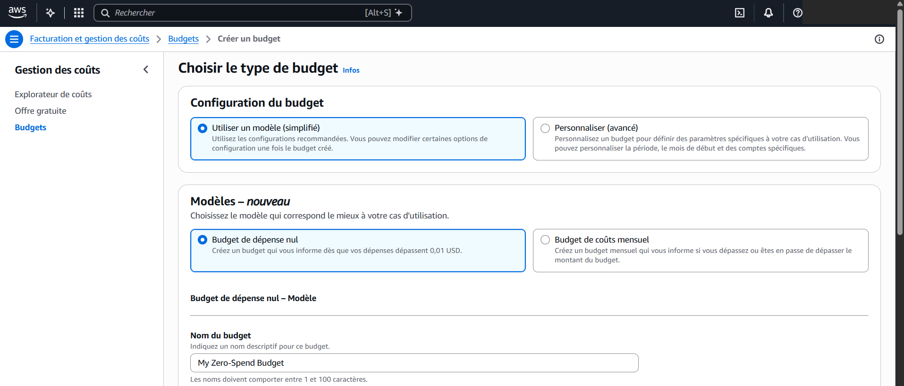

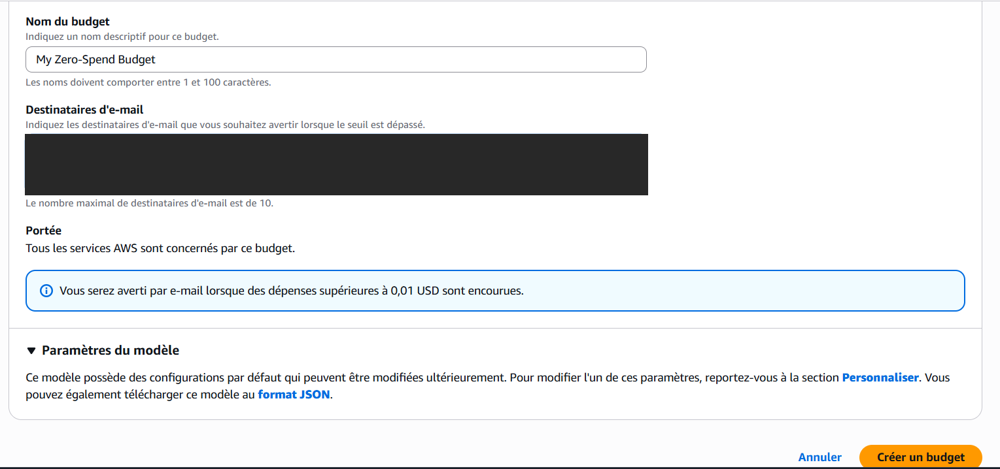

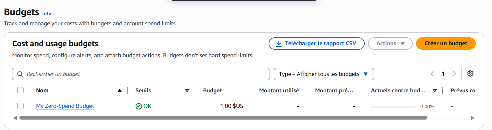

## IAM user

Why: the root account has unlimited power. If someone hacks it, they can delete everything and bill me. So I create an IAM user for daily work and keep root for rare cases.

In *IAM* > *Users* > *Create user*: I named the user `kadio-admin`, chose *Attach policies directly* and ticked the **AdministratorAccess** policy.

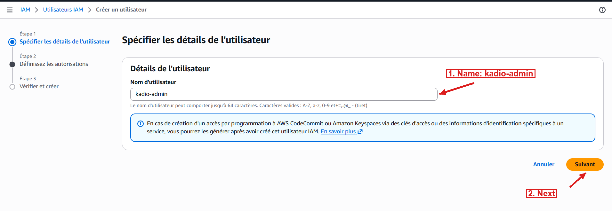

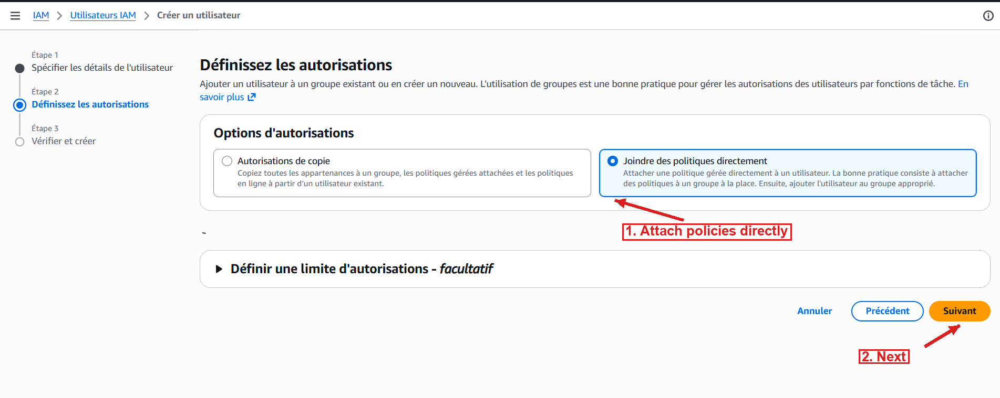

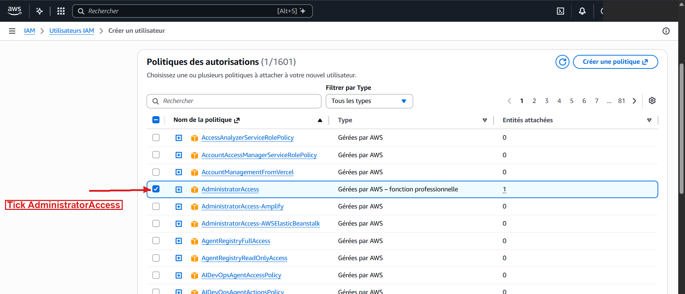

### Important: AdministratorAccess is not a limited policy

`AdministratorAccess` gives full access to every service of the AWS account. It is **not** a limited-permission policy, and my first version of this note was wrong to call it "limited rights".

I used it **temporarily**, because this is a personal learning account and I did not yet know which permissions each lesson needs. In a professional AWS environment, I would follow the **principle of least privilege**: give a user only the permissions required for the task. For this project, that means EC2 and its networking permissions (instances, key pairs, security groups) and read access to billing, nothing more.

In practice, this IAM user is not used for the project: the work was done with my AWS Builder ID, and console access is not available for the IAM user in this account. Because it is not needed, I replaced `AdministratorAccess` with a narrower managed policy, `AmazonEC2FullAccess`: it only covers EC2 (instances, key pairs, security groups), which is what this project uses.

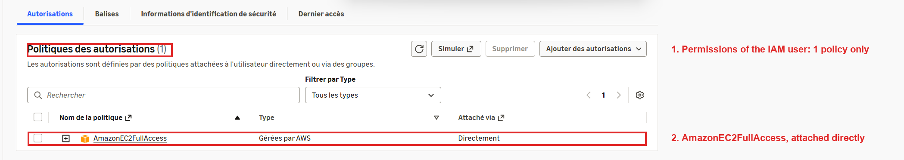

`AmazonEC2FullAccess` is still broad inside EC2. A stricter version would be a custom policy that only allows the exact actions I use (launch, stop and terminate instances, edit my security group) on my own resources.

## Limits of my account (MFA)

My account was created with the new AWS experience (linked to my AWS Builder ID, with a spending limit). In this experience:
- MFA and console access for the IAM user are not available;
- I would have to enable the "advanced features" to get them, but that is irreversible and it removes the spending limit of the free plan.

So I chose **not to enable them** and to keep the spending limit. To protect access to my account, I enabled two-step verification on my email address.

MFA for my **AWS Builder ID** (the identity I sign in with) is available somewhere else: in the profile, *Security* page, *Multi-factor authentication (MFA) devices* block > *Register a device*. I registered an authenticator app there: at each sign-in, AWS asks for a code in addition to the password.

## Creating the EC2 instance

In *EC2* > *Launch instance* (Europe/Stockholm region):
- **Name**: `lamp-server`
- **Image**: Ubuntu Server 24.04 LTS (free tier eligible)
- **Type**: `t3.micro` (free tier eligible)
- **Key pair**: `lamp-key` (`.pem` file, kept outside the Git repository)
- **Security group**: SSH (port 22) from *My IP* only, and HTTP (port 80) open to the Internet
- **Storage**: 8 GiB (default)

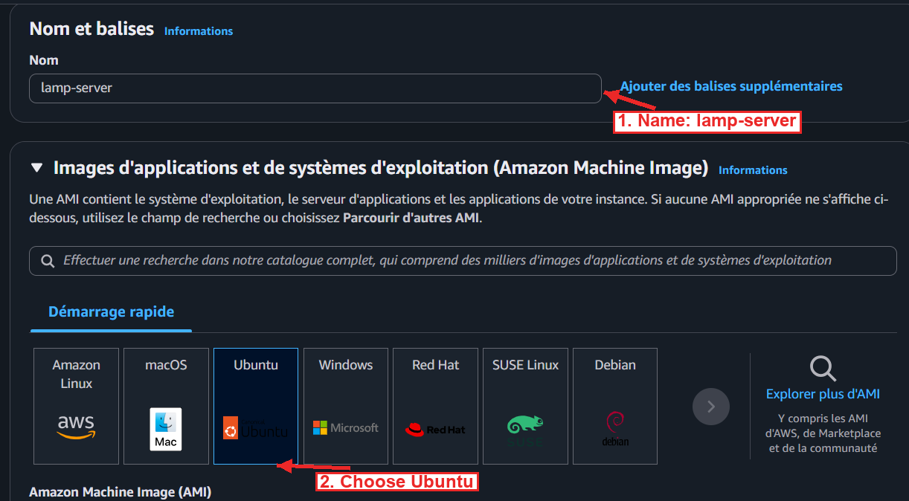

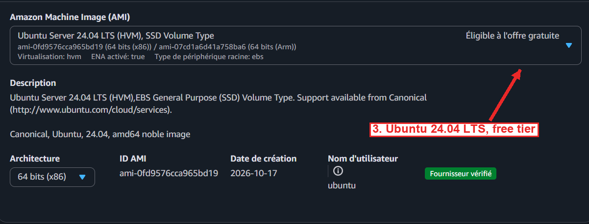

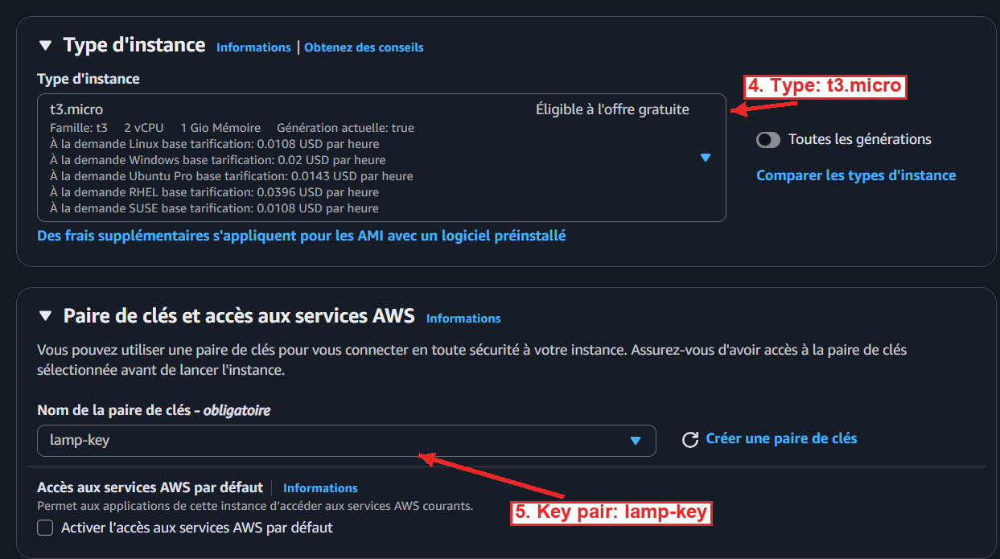

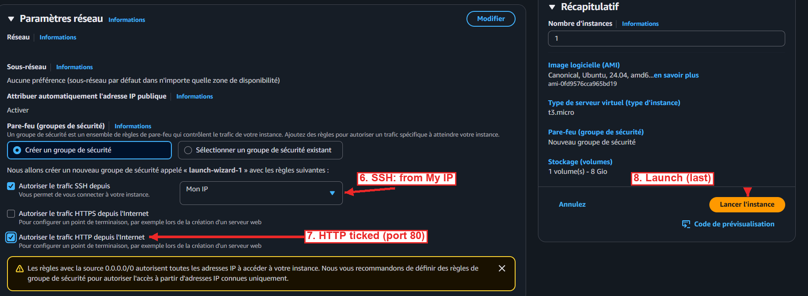

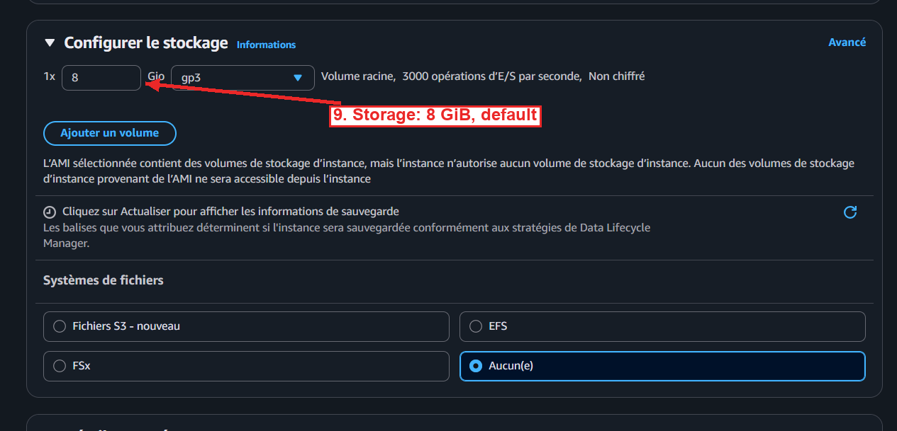

## SSH connection

Diagram: my PC (the client) connects to the EC2 instance over the Internet, using SSH on port 22 and the public IP of the instance.

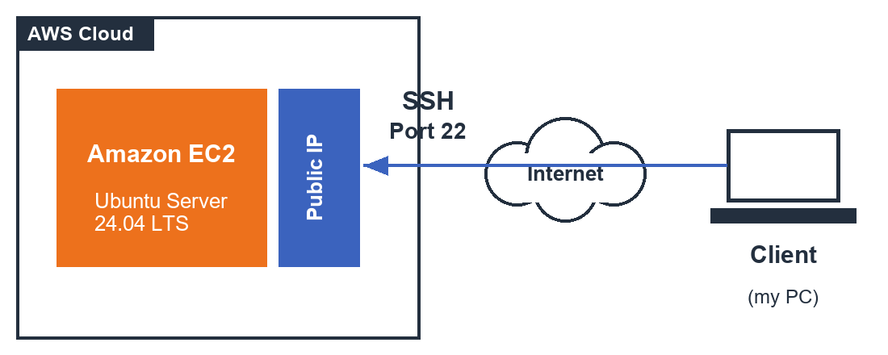

The key must be readable by me only, otherwise SSH refuses it. On Windows (PowerShell), I removed the inherited permissions with `icacls`, then gave read access to my user with `$env:USERNAME`.

```powershell
icacls lamp-key.pem /inheritance:r
icacls lamp-key.pem /grant:r "$($env:USERNAME):R"
ssh -i lamp-key.pem ubuntu@<public-ip-address>
```

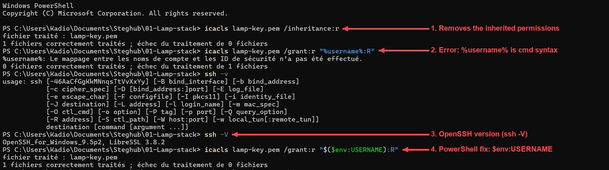

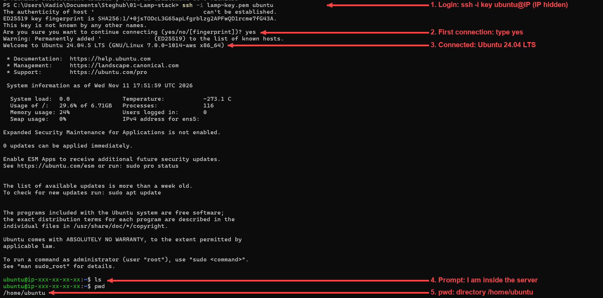

I'm connected to my Ubuntu 24.04 server (user `ubuntu`, directory `/home/ubuntu`).

## Things to remember

- Don't mix up **two different IPs**:

  | IP | Where to find it | What it is used for |
  |---|---|---|
  | Public IP of the **EC2 instance** (the server) | AWS console > EC2 > my instance > *Details* > *Public IPv4 address* | The `ssh` command and the website address in the browser (`http://<IP>`) |
  | Public IP of **my PC** (at home) | https://checkip.amazonaws.com/ | The SSH rule of the security group (*My IP*) |

  When I first tested the website in the browser, I used the checkip IP (my PC) instead of the instance IP: the page did not load.
- The public IP of the instance changes when I stop and restart it.
- If SSH times out or answers `Connection refused`, my IP may have changed: the SSH rule of the security group only allows my old IP. I check my current IP on https://checkip.amazonaws.com/, then update the rule: *EC2* > my instance > *Security* > the security group > *Edit inbound rules* > SSH > source **My IP**.
- To test whether port 22 is reachable: `Test-NetConnection <public-ip-address> -Port 22` (`TcpTestSucceeded : True` = it works).
- I stop the instance at the end of each session so I don't use up my credits.
