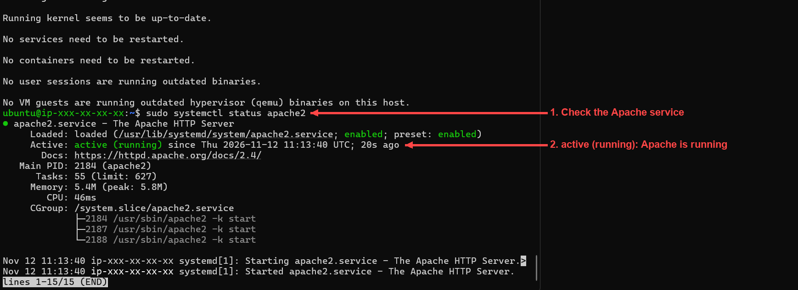
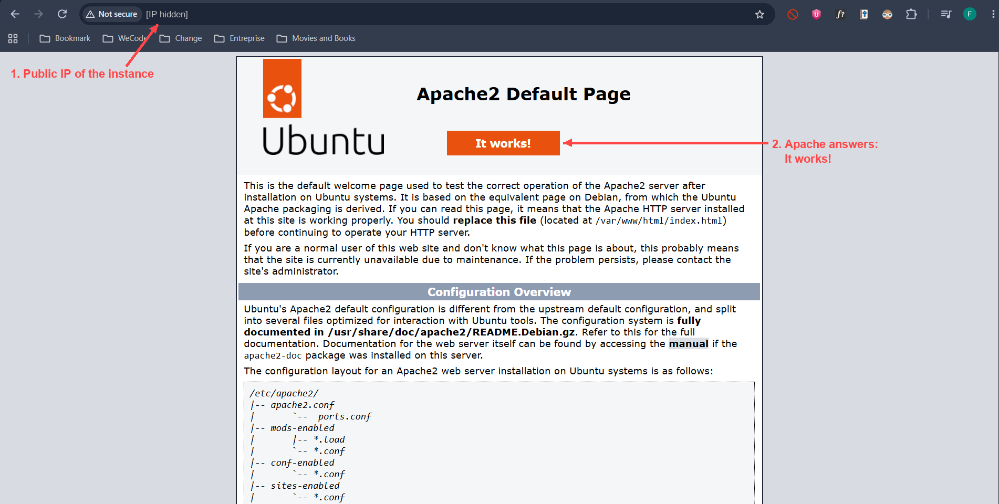

# Step 1: install Apache (lesson 103)

Apache is the web server: it receives requests from browsers and sends back pages. I install it with `apt`, the Ubuntu package manager.

## Installation

```bash
sudo apt update              # update the list of available packages
sudo apt install apache2 -y  # install Apache (-y answers yes to the prompts)
```

## Check that Apache is running

```bash
sudo systemctl status apache2
```

I look for `active (running)`. I press `q` to leave the screen.



## Test from the server (locally)

```bash
curl http://localhost:80
curl http://127.0.0.1:80
```

Both commands do almost the same thing: `curl` asks Apache for the page on port 80. `localhost` is the DNS name of the address `127.0.0.1`. The answer is HTML (the default Apache page), which proves Apache is responding.

## Test from the Internet

Port 80 (HTTP) is already open in the security group (source `0.0.0.0/0` = all IPs). In the browser:

```
http://<public-IP-of-the-instance>
```



Port 80 is the default port of browsers, so I don't need to type it. I must use `http://` (the server does not listen on HTTPS yet).

The public IP of the instance can also be retrieved from the server:

```bash
TOKEN=`curl -X PUT "http://169.254.169.254/latest/api/token" -H "X-aws-ec2-metadata-token-ttl-seconds: 21600"` && curl -H "X-aws-ec2-metadata-token: $TOKEN" -s http://169.254.169.254/latest/meta-data/public-ipv4
```

## Error I ran into

The page did not load in the browser: I had used the IP from https://checkip.amazonaws.com/ (the IP of my PC). I must use the **public IP of the instance** (see [102-aws-prerequisites.md](102-aws-prerequisites.md)).
