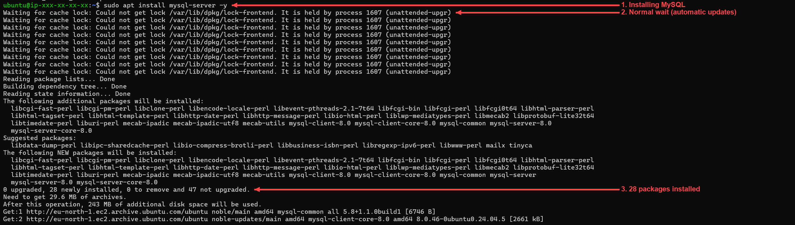
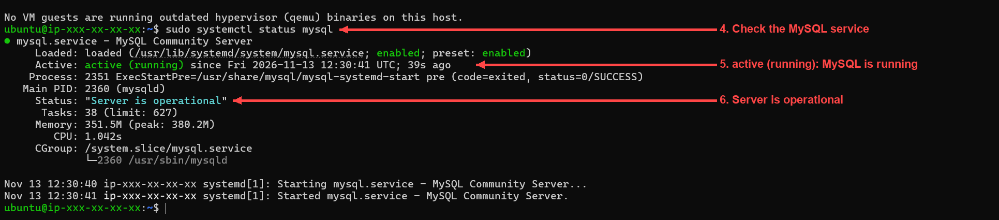
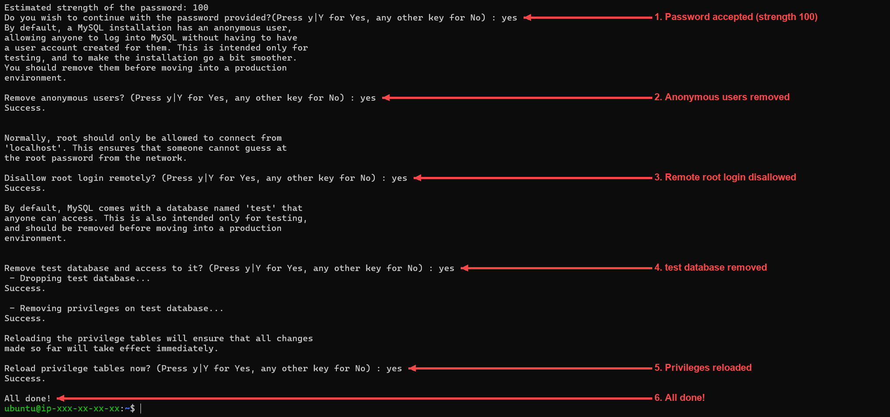
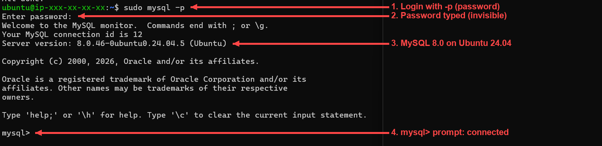

# Step 2: install MySQL (lesson 104)

MySQL is a relational database management system: it stores and manages the data of the website.

## Installation

```bash
sudo apt install mysql-server -y   # install the MySQL server (-y answers yes to the prompts)
```

At the beginning, `apt` printed "Waiting for cache lock" several times. This is normal: another process (`unattended-upgr`, Ubuntu's automatic updates) was using `apt`, and my command waited until it finished.



## Check that MySQL is running

```bash
sudo systemctl status mysql
```

I look for `active (running)` and `Server is operational`. I press `q` to leave the screen.



## Password of the MySQL root user

```bash
sudo mysql
```

This command connects me to MySQL as administrator, without a password, because `sudo` already gives me the rights. The prompt becomes `mysql>`.

```sql
ALTER USER 'root'@'localhost' IDENTIFIED WITH mysql_native_password BY '<my-password>';
exit
```

- A MySQL user is defined by a **name and a host**: `'root'@'localhost'` is the `root` that connects from the server itself. It is not the same account as `'root'@'%'` (from anywhere).
- `mysql_native_password` is the password login method that PHP can use.
- The MySQL `root` is not the Linux `root`.
- A command only runs when MySQL sees the `;`: until then it shows `->` (the command continues on the next line).
- Expected result: `Query OK, 0 rows affected`.

I never write my real MySQL password in this file: I use `'<my-password>'`.

## Securing MySQL

```bash
sudo mysql_secure_installation
```

This script removes dangerous default settings. I enabled the password validation plugin (level 1, MEDIUM), then answered `yes` to all the questions:
- continue with the chosen password (estimated strength 100);
- remove anonymous users;
- disallow remote root login (it can only connect from the server);
- remove the `test` database;
- reload the privilege tables to apply the changes.



## Testing the connection with the password

```bash
sudo mysql -p
```

`-p` asks for the password (nothing is displayed while I type it). The `mysql>` prompt confirms that it works. I leave with `exit`.

For the next projects, it is better to create a dedicated user with fewer rights for each database, instead of using `root`. With MySQL 8, a user for a PHP application must use `mysql_native_password`.


