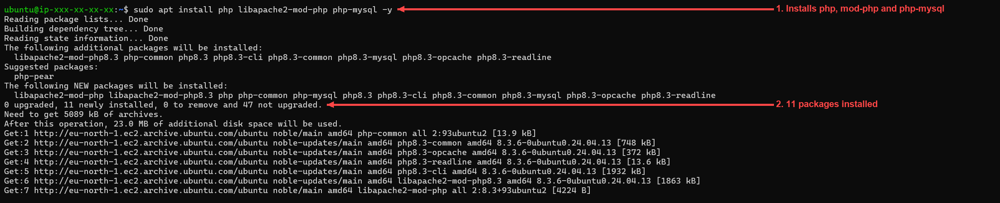
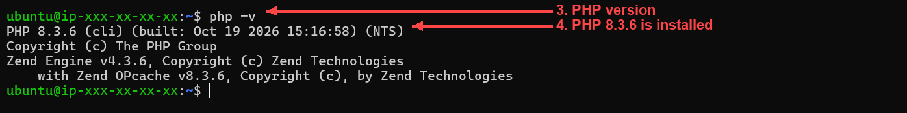
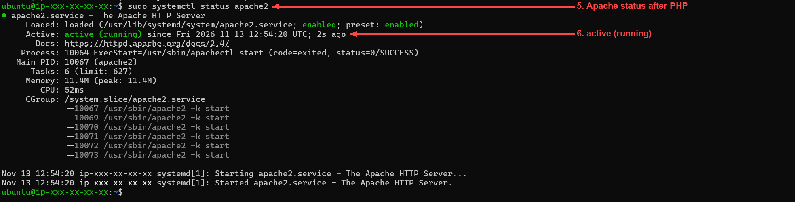
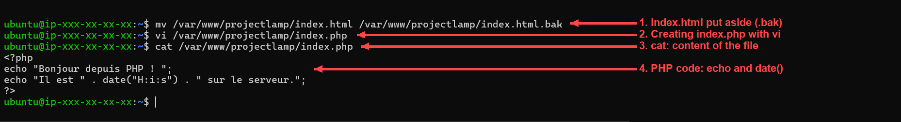
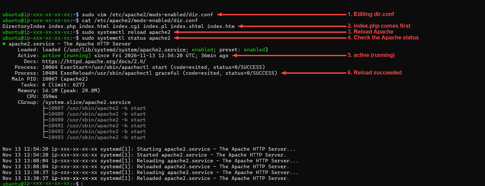
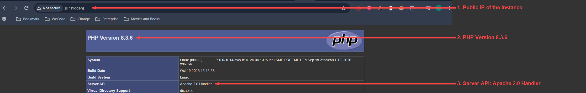
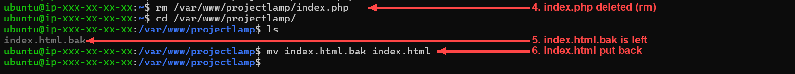

# Step 3: install PHP (lessons 105 and 107)

PHP is the language that processes code and generates the dynamic content of pages. It is the last component of the LAMP stack.

## Installation

```bash
sudo apt install php libapache2-mod-php php-mysql -y
```

Three packages, three roles:
- `php`: the language itself, which runs the code;
- `libapache2-mod-php`: the module that lets Apache pass `.php` files to PHP;
- `php-mysql`: the module that lets PHP talk to MySQL.



## Check the version

```bash
php -v
```

PHP 8.3.6 is installed.



## Check that Apache is still running

```bash
sudo systemctl status apache2
```

`libapache2-mod-php` enables its module and reloads Apache. The service is `active (running)`.



## The LAMP stack is complete

- [x] Linux (Ubuntu 24.04)
- [x] Apache
- [x] MySQL
- [x] PHP

## Testing PHP with an index.php page

To check that PHP runs correctly through Apache, I replaced the `index.html` page of the virtual host (see [106-virtualhost.md](106-virtualhost.md)) with an `index.php`.

```bash
mv /var/www/projectlamp/index.html /var/www/projectlamp/index.html.bak   # Apache serves index.html before index.php, so I put it aside
vi /var/www/projectlamp/index.php
cat /var/www/projectlamp/index.php
```

```php
<?php
echo "Bonjour depuis PHP ! ";
echo "Il est " . date("H:i:s") . " sur le serveur.";
?>
```

(The page text is in French: "Hello from PHP! It is <time> on the server.")

- `<?php ... ?>` delimits the PHP code and `echo` prints text.
- `date("H:i:s")` returns the server time each time the page loads: if the time changes when I reload the page, the page is dynamic.




## Giving priority to index.php (lesson 107)

By default, Apache looks for the home page in the order given by `DirectoryIndex`: `index.html` comes before `index.php`. This is useful to show a maintenance page by creating a temporary `index.html`. To make `index.php` come first, I changed the order in `dir.conf`:

```bash
sudo vim /etc/apache2/mods-enabled/dir.conf   # sudo: the file belongs to root
cat /etc/apache2/mods-enabled/dir.conf        # check
sudo systemctl reload apache2                 # apply without stopping Apache
sudo systemctl status apache2                 # check that Apache is running
```

The line became:

```
DirectoryIndex index.php index.html index.cgi index.pl index.xhtml index.htm
```



## Test with phpinfo()

I created an `index.php` that contains only:

```php
<?php
phpinfo();
```

`phpinfo()` generates a page that describes the PHP configuration of the server. Opening the website in the browser, I see "PHP Version 8.3.6" and `Server API: Apache 2.0 Handler`, which confirms that PHP is plugged into Apache.



This page contains sensitive information about the server (paths, modules, environment). So I only keep the top of the page in the screenshot, and I delete the file right after:

```bash
rm /var/www/projectlamp/index.php                    # delete the file (no recycle bin on Linux)
cd /var/www/projectlamp/ && ls
mv index.html.bak index.html                         # put my original home page back
```



Since `index.php` no longer exists, Apache now serves `index.html` (the second one in the `DirectoryIndex` order).
