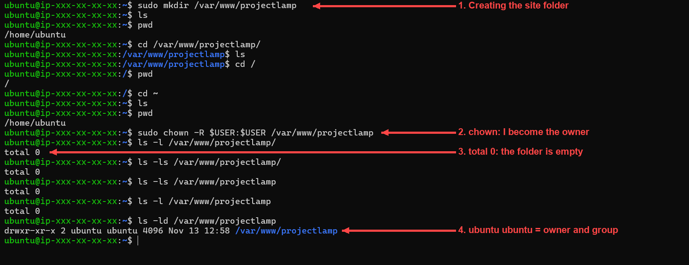
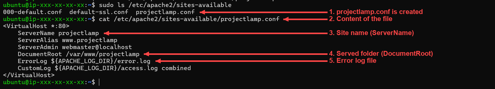
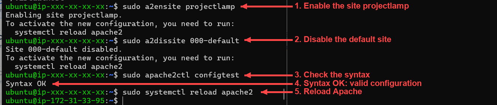
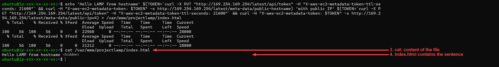

# Step 4: create an Apache virtual host (lesson 106)

A virtual host lets one Apache server (with one public IP) host several websites: Apache looks at the name requested by the browser and serves the right folder. I create a first site, `projectlamp`.

## The site folder

```bash
sudo mkdir /var/www/projectlamp                 # create the web root of the site (sudo: /var/www belongs to root)
sudo chown -R $USER:$USER /var/www/projectlamp  # I become the owner of the folder and its content
ls -ld /var/www/projectlamp                     # check the owner and the permissions
```

- `$USER` is a variable that contains my current user (`ubuntu`).
- Being the owner lets me edit the site files without `sudo`.
- `total 0` means the folder is empty for now.
- `drwxr-xr-x 2 ubuntu ubuntu`: it is a directory (`d`), owner and group `ubuntu`.



## The configuration file

```bash
sudo vi /etc/apache2/sites-available/projectlamp.conf
```

`sudo` is needed because `/etc/apache2` belongs to `root`. In `vi`, I press `i` to type, paste the configuration, then `Esc`, `:wq` and Enter to save.

```apache
<VirtualHost *:80>
    ServerName projectlamp
    ServerAlias www.projectlamp
    ServerAdmin webmaster@localhost
    DocumentRoot /var/www/projectlamp
    ErrorLog ${APACHE_LOG_DIR}/error.log
    CustomLog ${APACHE_LOG_DIR}/access.log combined
</VirtualHost>
```

- `<VirtualHost *:80>`: this site answers on port 80, whatever the IP.
- `ServerName` and `ServerAlias`: the domain names this site answers to (useless when I test with the IP).
- `DocumentRoot`: the folder served by Apache, the one I just created.
- `ErrorLog` and `CustomLog`: the files where Apache writes its errors and its access logs.

I check that the file exists and what it contains:

```bash
sudo ls /etc/apache2/sites-available
cat /etc/apache2/sites-available/projectlamp.conf
```



## Enabling the site

```bash
sudo a2ensite projectlamp       # enable my site (link in sites-enabled)
sudo a2dissite 000-default      # disable the default Apache site
sudo apache2ctl configtest      # check the syntax of the configuration
sudo systemctl reload apache2   # reload Apache without stopping it
```

- A file in `sites-available` is only an available configuration: `a2ensite` creates the link in `sites-enabled`, the folder Apache really reads.
- I disable the default site, otherwise it would answer instead of mine when I test with the IP.
- `configtest` must answer `Syntax OK` before I reload.
- `reload` applies the configuration without cutting Apache (unlike `restart`).



## Testing with an index.html page

The site folder is still empty. I create an `index.html` that contains the public DNS name and the public IP of the instance, obtained from the AWS metadata service (`169.254.169.254`, only reachable from the instance):

```bash
echo 'Hello LAMP from hostname' $(TOKEN=`curl -X PUT "http://169.254.169.254/latest/api/token" -H "X-aws-ec2-metadata-token-ttl-seconds: 21600"` && curl -H "X-aws-ec2-metadata-token: $TOKEN" -s http://169.254.169.254/latest/meta-data/public-hostname) 'with public IP' $(TOKEN=`curl -X PUT "http://169.254.169.254/latest/api/token" -H "X-aws-ec2-metadata-token-ttl-seconds: 21600"` && curl -H "X-aws-ec2-metadata-token: $TOKEN" -s http://169.254.169.254/latest/meta-data/public-ipv4) > /var/www/projectlamp/index.html
cat /var/www/projectlamp/index.html
```

- `echo` writes the text, and `>` sends it into the file instead of printing it.
- The `$(...)` are sub-commands: their result is inserted in the text.
- I don't need `sudo`, because I own the folder (thanks to `chown`).



## Result in the browser

With the public IP of the instance:


With the public DNS name, the result is the same:


My virtual host works: it is my site that answers, and no longer the default Apache page (disabled with `a2dissite`).

## Things to remember

- An `index.html` file has priority over an `index.php` in the web root. When I create an `index.php`, I will rename or delete `index.html`.
- The public IP changes if I stop and restart the instance.
