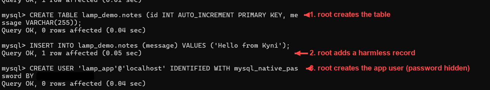
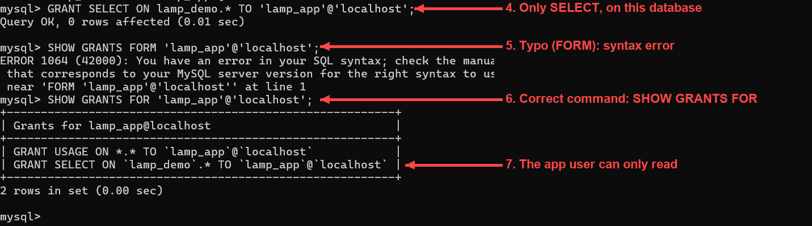
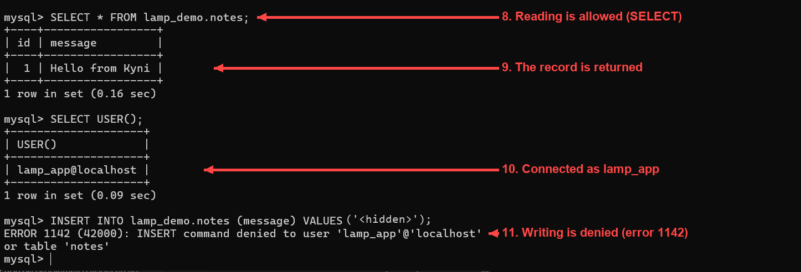
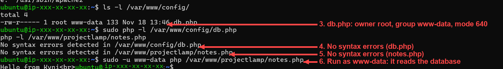
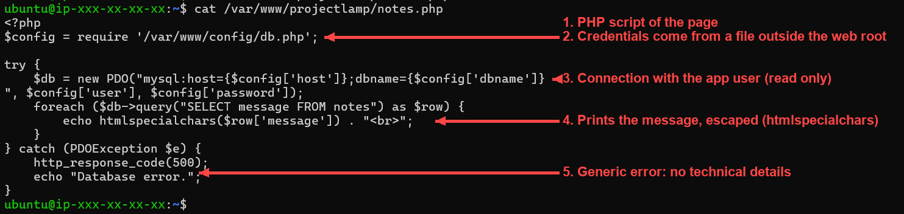

# Step 6: PHP-to-MySQL test with a dedicated database user

My first version proved that Apache, MySQL and PHP work, but not that they work **together**. After the review, I added a small PHP page that reads a record from MySQL. The rules I followed:
- the web application does **not** use the MySQL `root` account;
- it uses a dedicated user with **limited privileges** (read only);
- the database credentials are **never** committed to GitHub.

## Database, table and dedicated user

The administrator (`root`) prepares the database. The application user only gets what it needs.

```bash
sudo mysql -p
```

```sql
CREATE DATABASE lamp_demo;
CREATE TABLE lamp_demo.notes (id INT AUTO_INCREMENT PRIMARY KEY, message VARCHAR(255));
INSERT INTO lamp_demo.notes (message) VALUES ('Hello from Kyni');
CREATE USER 'lamp_app'@'localhost' IDENTIFIED WITH mysql_native_password BY '<my-password>';
GRANT SELECT ON lamp_demo.* TO 'lamp_app'@'localhost';
```

- `root` creates the database, the table and a harmless test record (administration tasks).
- `lamp_app` can only connect from the server itself (`'localhost'`).
- `GRANT SELECT ON lamp_demo.*` gives read access to this database only: no `INSERT`, `UPDATE`, `DELETE` or `DROP`.
- The password follows the MEDIUM rule of the validation plugin. I never write the real password in this repository.



I check the rights of the user, then I test them while connected as `lamp_app`:

```sql
SHOW GRANTS FOR 'lamp_app'@'localhost';
```



```bash
mysql -u lamp_app -p
```

```sql
SELECT * FROM lamp_demo.notes;
SELECT USER();
INSERT INTO lamp_demo.notes (message) VALUES ('test');
```

The `SELECT` works, but the `INSERT` is refused with `ERROR 1142 ... INSERT command denied`. This proves the least-privilege rule: the application can read the data, not change it.



## Credentials outside the web root

The password must not be inside the folder served by Apache. I keep it in a configuration file next to the web root:

```bash
sudo mkdir /var/www/config
sudo nano /var/www/config/db.php           # returns the host, database, user and password
sudo chown root:www-data /var/www/config/db.php
sudo chmod 640 /var/www/config/db.php
ls -l /var/www/config/
```

- `/var/www/config` is **outside** `/var/www/projectlamp`, so the web server never serves it.
- Apache runs as `www-data`: the group `www-data` can read the file (`640`), and other users cannot.
- The file is never added to GitHub: this repository only contains `<my-password>` placeholders.

The file has this shape (with my real password on the server only):

```php
<?php
return [
    'host' => 'localhost',
    'dbname' => 'lamp_demo',
    'user' => 'lamp_app',
    'password' => '<my-password>',
];
```

## The PHP page

```bash
nano /var/www/projectlamp/notes.php
```

```php
<?php
$config = require '/var/www/config/db.php';

try {
    $db = new PDO("mysql:host={$config['host']};dbname={$config['dbname']}", $config['user'], $config['password']);
    foreach ($db->query("SELECT message FROM notes") as $row) {
        echo htmlspecialchars($row['message']) . "<br>";
    }
} catch (PDOException $e) {
    http_response_code(500);
    echo "Database error.";
}
```

- `require` loads the configuration file, which returns the credentials.
- The page connects with the read-only user, reads the messages and prints them. `htmlspecialchars` neutralizes any HTML characters.
- On failure, it only prints "Database error.": it does not show the technical error, which could reveal details about the server.

## Checking and result

The page was blank at first: PHP errors are not displayed in the browser on this server (this is intended), so I checked step by step:

```bash
ls -l /var/www/config/                          # owner root, group www-data, mode 640
sudo php -l /var/www/config/db.php              # syntax check of the configuration
php -l /var/www/projectlamp/notes.php           # syntax check of the page
sudo -u www-data php /var/www/projectlamp/notes.php   # run the page as the Apache user
```

`php -l` answers `No syntax errors detected`. Running the page as `www-data` prints the record, which confirms that Apache's user can read the configuration and query the database.





In the browser, `/notes.php` now displays the record read from MySQL:


The full LAMP stack works together: Apache receives the request, PHP runs the script, PHP reads the data in MySQL with a limited user, and the result goes back to the browser.

## What I learned

- Separate the **administrator** access from the **application** access: dedicated user, minimum privileges.
- Keep credentials **out of the web root and out of GitHub**.
- A blank PHP page usually hides an error: I check the Apache log, the file permissions and the syntax, and I test as the web server user.
