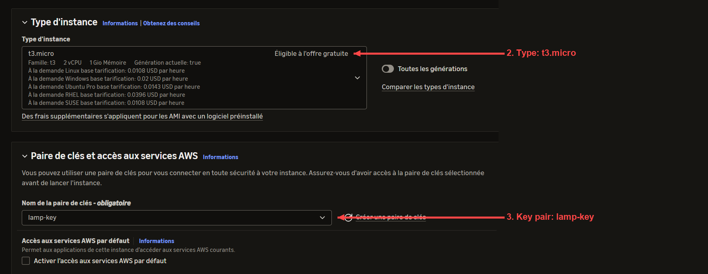
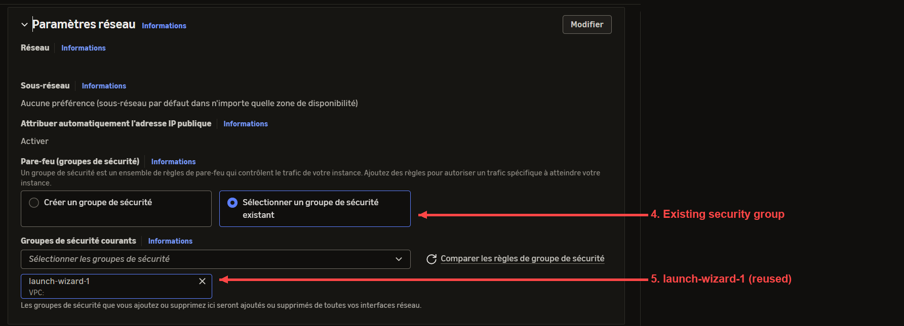
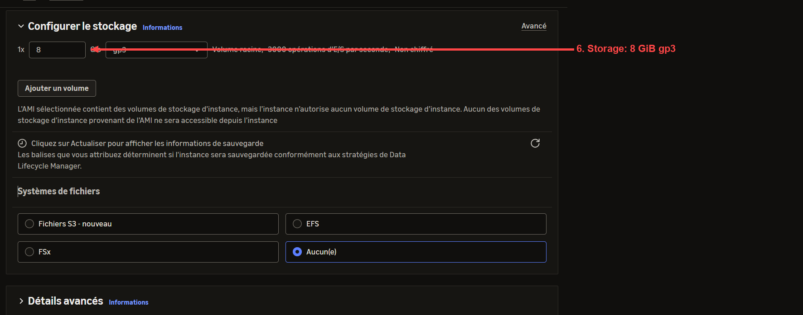
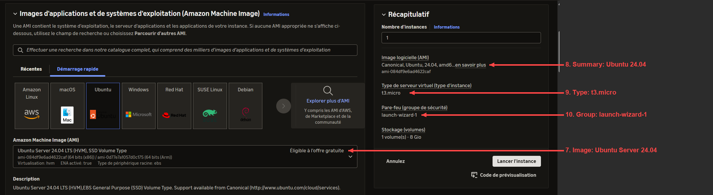
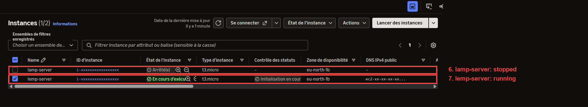
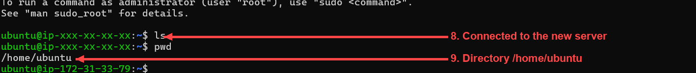

# Step 0: EC2 instance for the LEMP stack (lesson 102)

For this project, I created a second instance, `lemp-server`, instead of reusing the one from module 01: Nginx and Apache would fight for port 80, and `lamp-server` stays untouched (stopped) for the previous assignment.

## Configuration

In *EC2* > *Launch instance*:
- **Name**: `lemp-server`
- **Image**: **Ubuntu Server 24.04 LTS**. The console proposed 26.04 by default, the most recent one: I changed it, because the course and its commands (PHP version, `mysql_native_password`) are written for 24.04.
- **Type**: `t3.micro` (free tier eligible)
- **Key pair**: `lamp-key`, the same as for module 01
- **Security group**: the existing group `launch-wizard-1` (SSH from my IP, HTTP port 80)
- **Storage**: 8 GiB (default)










## Instances and SSH connection

`lamp-server` is stopped, `lemp-server` is running. I connect with the same key, using the public IP of the new instance:

```powershell
ssh -i lamp-key.pem ubuntu@<public-ip-address>
```





The server name in the prompt (`ip-172-31-33-79`) is different from the one of `lamp-server`: it is really the new machine.

## Things to remember

- Each instance has its own public IP, which changes when it is stopped and restarted.
- The security group is shared: if my IP changes, I update the SSH rule only once for both instances.
- I only run one instance at a time to save my credits.
