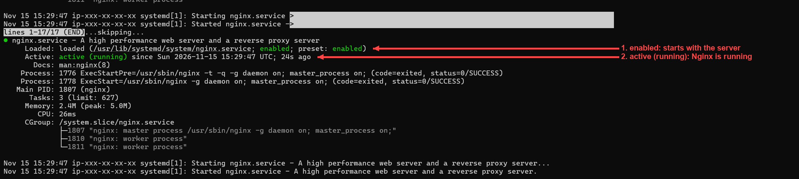
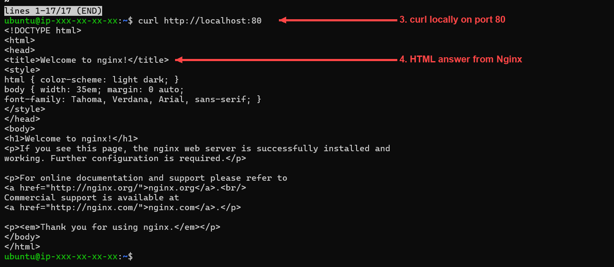
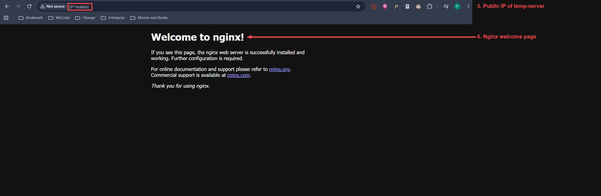

# Step 1: install Nginx (lesson 103)

Nginx ("engine x") is the web server of the LEMP stack: it replaces Apache. It receives requests from browsers and sends back pages.

## Installation

```bash
sudo apt update              # update the list of packages
sudo apt install nginx -y    # install Nginx (-y answers yes to the prompts)
```

## Check that Nginx is running

```bash
sudo systemctl status nginx
```

I look for `active (running)` and `enabled` (the service restarts with the server). I press `q` to leave the screen.



## Test from the server

```bash
curl http://localhost:80
```

`curl` asks Nginx for the page on port 80: the answer is HTML (the title "Welcome to nginx!"), so Nginx is responding.



## Test from the Internet

Port 80 is already open in the security group. In the browser: `http://<public-IP-of-lemp-server>`.



I must use the public IP of **this** instance (`lemp-server`), not the one of `lamp-server` and not the one of my PC.
