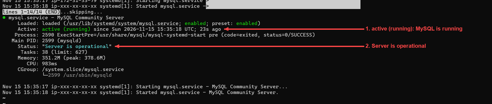
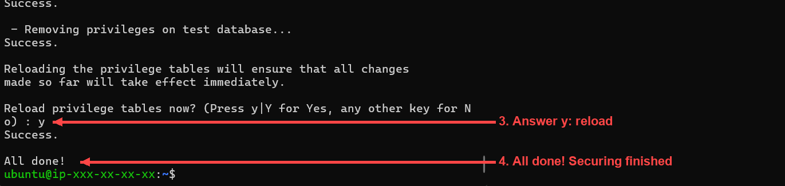
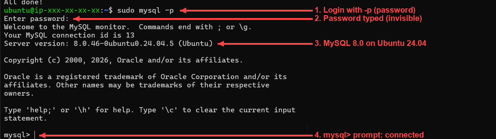

# Step 2: install MySQL (lesson 104)

MySQL is the database management system of the LEMP stack: it stores the data of the website. The installation is the same as in module 01 (see [104-mysql.md](../01-lamp-stack/104-mysql.md)).

## Installation and check

```bash
sudo apt install mysql-server -y     # install the MySQL server
sudo systemctl status mysql          # check that it is running (q to leave)
```

I look for `active (running)` and `Server is operational`.



## Password of the MySQL root user

```bash
sudo mysql
```

```sql
ALTER USER 'root'@'localhost' IDENTIFIED WITH mysql_native_password BY '<my-password>';
exit
```

A MySQL user is defined by a **name and a host**: `'root'@'localhost'` is the `root` that connects from the server itself. I never write my real password in this file.

## Securing MySQL

```bash
sudo mysql_secure_installation
```

I enabled the password validation plugin (level 1, MEDIUM), then answered `y` to the questions: remove anonymous users, disallow remote root login, remove the `test` database, reload the privilege tables.



## Testing the connection with the password

```bash
sudo mysql -p
```

`-p` asks for the password (nothing is displayed when I type it). The `mysql>` prompt confirms that it works, and I leave with `exit`.


