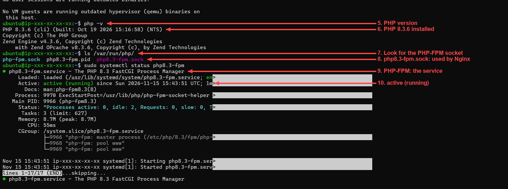

# Step 3: install PHP-FPM (lesson 105)

PHP processes code and generates the dynamic content of pages. With Apache, PHP was built into the server (`libapache2-mod-php`). With Nginx, it is not: PHP runs in a separate process, **PHP-FPM** (*FastCGI Process Manager*), and Nginx passes the `.php` files to it.

## Installation

```bash
sudo apt install php-fpm php-mysql -y
```

- `php-fpm`: the PHP process manager that Nginx will call;
- `php-mysql`: the module that lets PHP communicate with MySQL.

## Check

```bash
php -v                           # PHP version
ls /var/run/php/                 # look for the PHP-FPM socket
sudo systemctl status php8.3-fpm # is the service running?
```

PHP 8.3.6 is installed. The socket is `php8.3-fpm.sock`: this is the file Nginx will use to talk to PHP-FPM (I will find it again in the server block configuration). The service is `active (running)`.


