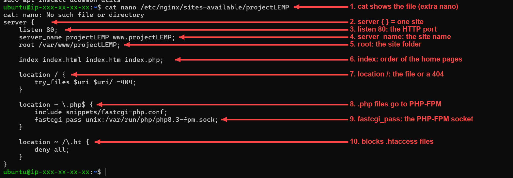
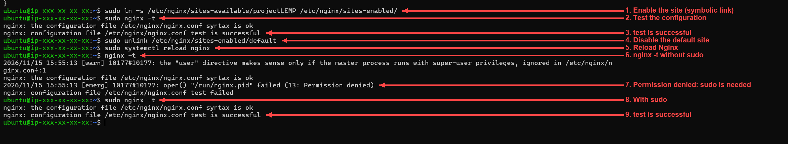
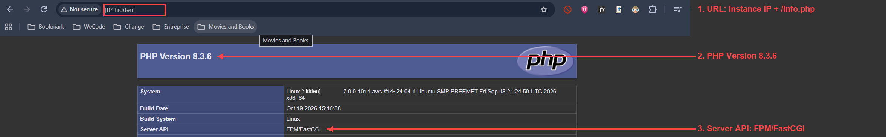

# Step 4: configure Nginx with a server block (lesson 106)

A server block is the equivalent of an Apache virtual host: a configuration that tells Nginx which folder to serve and how to handle `.php` files.

## The site folder

```bash
sudo mkdir /var/www/projectLEMP                  # create the web root of the site
sudo chown -R $USER:$USER /var/www/projectLEMP   # I become the owner (I can edit without sudo)
```

## The configuration file

```bash
sudo nano /etc/nginx/sites-available/projectLEMP
```

Here is the configuration with a comment on each line (in the file on the server, I did not write the comments):

```nginx
server {                                         # a server block = one site
    listen 80;                                   # listen on port 80 (HTTP)
    server_name projectLEMP www.projectLEMP;     # the names this site answers to
    root /var/www/projectLEMP;                   # the folder that contains the files of the site

    index index.html index.htm index.php;        # order of the home pages to look for

    location / {                                 # for all the addresses of the site
        try_files $uri $uri/ =404;               # look for the file, then the folder, otherwise a 404 error
    }

    location ~ \.php$ {                          # for the files that end with .php
        include snippets/fastcgi-php.conf;       # standard settings to pass the PHP
        fastcgi_pass unix:/var/run/php/php8.3-fpm.sock;  # the PHP-FPM socket, which runs the code
    }

    location ~ /\.ht {                           # for .htaccess files (specific to Apache)
        deny all;                                # access denied: Nginx does not use them
    }
}
```

## What the blocks do

| Block | Role |
|---|---|
| `server { }` | Defines a site (a "server block"). |
| `listen 80` | Port Nginx listens on: 80, the default HTTP port. |
| `server_name` | The domain names (or the IP) this block answers to. |
| `root` | The folder that contains the files of the site. |
| `index` | The order of the home pages. Putting `index.html` before `index.php` makes it possible to show a maintenance page by creating a temporary `index.html`. |
| `location /` | Applies to all the addresses. `try_files` looks for the requested file, then the folder, and returns a 404 error if it does not exist. |
| `location ~ \.php$` | Applies to `.php` files: Nginx passes them to PHP-FPM through its socket. |
| `location ~ /\.ht` | Denies access to `.htaccess` files, which are not used with Nginx, so they are never displayed. |

The name of the socket (`php8.3-fpm.sock`) comes from the previous step (`ls /var/run/php/`).

## Checking the file

```bash
cat /etc/nginx/sites-available/projectLEMP
```



The command first displayed `cat: nano: No such file or directory`: I had typed `cat nano /etc/...`, and `cat` looked for a file called `nano`. The content of the right file was displayed right after. To display a file, I use `cat <path>` (without `nano`): `nano` is for editing.

## Enabling the site

```bash
sudo ln -s /etc/nginx/sites-available/projectLEMP /etc/nginx/sites-enabled/   # enable the site (symbolic link)
sudo nginx -t                                                                 # test the syntax of the configuration
sudo unlink /etc/nginx/sites-enabled/default                                  # disable the default site
sudo systemctl reload nginx                                                   # reload Nginx without stopping it
```

- A file in `sites-available` is only an available configuration: `ln -s` creates a symbolic link (a shortcut) in `sites-enabled`, the folder Nginx really reads. It is the same idea as `a2ensite` with Apache.
- `nginx -t` must answer `syntax is ok` and `test is successful` before I reload.
- I disable the default site, otherwise it would answer instead of mine.



I also ran `nginx -t` **without** `sudo`: the syntax was fine, but the test failed with `open() "/run/nginx.pid" failed (13: Permission denied)`. This is not a configuration error: the test needs to write to `/run/nginx.pid`, which only `root` can do. With `sudo nginx -t`, everything passes.

## Testing with an index.html page

The site folder is empty at first. I create an `index.html` that contains the public DNS name and the public IP of the instance, obtained from the AWS metadata service (`169.254.169.254`, only reachable from the instance):

```bash
echo 'Hello LEMP from hostname' $(TOKEN=`curl -X PUT "http://169.254.169.254/latest/api/token" -H "X-aws-ec2-metadata-token-ttl-seconds: 21600"` && curl -H "X-aws-ec2-metadata-token: $TOKEN" -s http://169.254.169.254/latest/meta-data/public-hostname) 'with public IP' $(TOKEN=`curl -X PUT "http://169.254.169.254/latest/api/token" -H "X-aws-ec2-metadata-token-ttl-seconds: 21600"` && curl -H "X-aws-ec2-metadata-token: $TOKEN" -s http://169.254.169.254/latest/meta-data/public-ipv4) > /var/www/projectLEMP/index.html
```

`echo` writes the text, `>` sends it into the file, and the `$(...)` insert the result of the sub-commands. I don't need `sudo`: I own the folder.

In the browser, with the public IP of the instance, my page is displayed instead of "Welcome to nginx!": the default site is disabled and my server block is the one answering.


## Testing PHP with Nginx

To check that Nginx passes `.php` files to PHP-FPM, I created an `info.php` file:

```bash
nano /var/www/projectLEMP/info.php
```

```php
<?php
phpinfo();
```

In the browser, with `/info.php` at the end of the address, the "PHP Version 8.3.6" page is displayed. The line `Server API: FPM/FastCGI` confirms that PHP goes through PHP-FPM.



This page contains sensitive information about the server: I only keep the top of the page in the screenshot, and I delete the file right after.

```bash
sudo rm /var/www/projectLEMP/info.php
```

After the deletion, the same address returns `404 Not Found`: this is normal, the file no longer exists.


