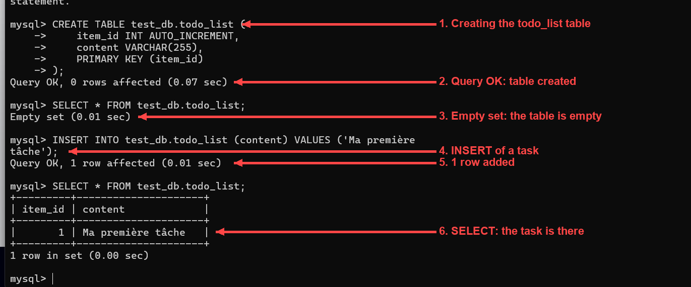
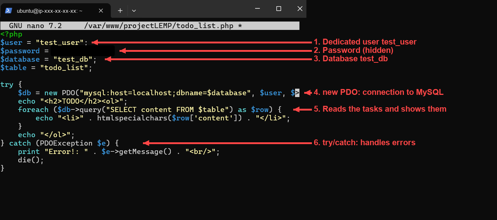
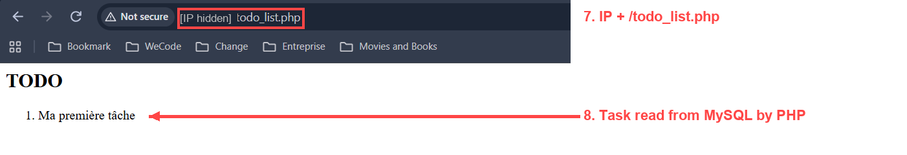
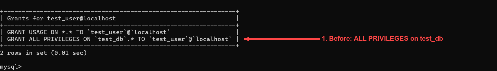
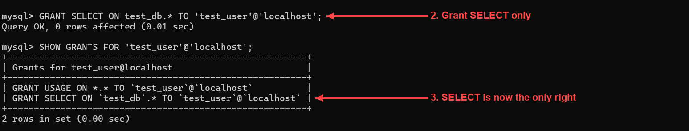
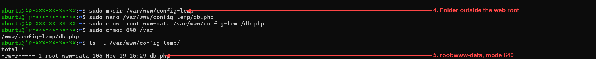
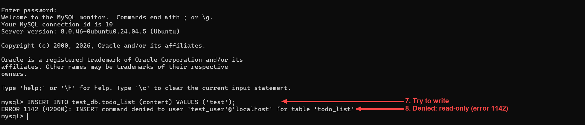

# Step 5: read MySQL data with PHP (lesson 107)

Last test of the LEMP stack: a PHP page connects to MySQL and displays data. I start by preparing the database, a dedicated user and a table.

## Database and dedicated user

```sql
CREATE DATABASE test_db;
CREATE USER 'test_user'@'localhost' IDENTIFIED WITH mysql_native_password BY '<my-password>';
GRANT ALL ON test_db.* TO 'test_user'@'localhost';
```

- I create a dedicated user instead of using `root`, so the application only has access to its own database (least privilege).
- `GRANT ALL ON test_db.*` gives all rights on the `test_db` database only. `ALL` and `ALL PRIVILEGES` are the same command.
- `'localhost'`: this user can only connect from the server itself.
- The password must follow the MEDIUM rule of the validation plugin (8 characters or more, uppercase, lowercase, digit, symbol), otherwise MySQL answers `ERROR 1819 ... does not satisfy the current policy requirements`.
- I never write the real password in this file.

## The todo_list table

I connect with the dedicated user:

```bash
mysql -u test_user -p
```

```sql
CREATE TABLE test_db.todo_list (
    item_id INT AUTO_INCREMENT,
    content VARCHAR(255),
    PRIMARY KEY (item_id)
);
INSERT INTO test_db.todo_list (content) VALUES ('My first task');
SELECT * FROM test_db.todo_list;
```

- `item_id INT AUTO_INCREMENT`: a number that increases by itself.
- `content VARCHAR(255)`: the text of the task (255 characters at most).
- `PRIMARY KEY (item_id)`: identifies each row in a unique way.
- `INSERT INTO ... VALUES` adds a row, `SELECT *` displays all the rows.



## The PHP script

```bash
nano /var/www/projectLEMP/todo_list.php
```

```php
<?php
$user = "test_user";
$password = "<my-password>";
$database = "test_db";
$table = "todo_list";

try {
    $db = new PDO("mysql:host=localhost;dbname=$database", $user, $password);
    echo "<h2>TODO</h2><ol>";
    foreach ($db->query("SELECT content FROM $table") as $row) {
        echo "<li>" . htmlspecialchars($row['content']) . "</li>";
    }
    echo "</ol>";
} catch (PDOException $e) {
    print "Error!: " . $e->getMessage() . "<br/>";
    die();
}
```

- The four variables group the user, the password, the database and the table.
- `new PDO(...)` opens the connection to MySQL, with the dedicated user.
- `$db->query("SELECT content ...")` reads the tasks, and the `foreach` displays them in a numbered list.
- `htmlspecialchars` neutralizes any HTML characters in the text of the tasks.
- The `try/catch` displays an error if the connection fails.

In the screenshot, the password is hidden.



## Result in the browser

With the public IP of the instance and `/todo_list.php`, the page displays the task read from MySQL:



The whole LEMP stack works: Nginx receives the request, PHP-FPM runs the script, PHP reads the table in MySQL, and the result goes back to the browser.

## Why the browser does not ask for a password

The password is in the PHP script, which runs **on the server**: it is PHP that connects to MySQL, not the visitor. The browser only receives the HTML that is produced (the list), never the code or the password. This also means the page is public: anyone with the address can see the list, without any authentication.

This first version has two weaknesses, which I fixed in the next section: the password is written in a file of the web folder, and the user can do much more than the page needs.

## Hardening: least privilege and credentials outside the web root

I applied the same rules as in the LAMP project.

**1. Read-only database user.** The page only reads data, so `test_user` does not need `ALL`. First, the rights it had:



```sql
REVOKE ALL PRIVILEGES ON test_db.* FROM 'test_user'@'localhost';
GRANT SELECT ON test_db.* TO 'test_user'@'localhost';
SHOW GRANTS FOR 'test_user'@'localhost';
```

`REVOKE` removes every right, `GRANT SELECT` gives back the read access only.



**2. Credentials in a file outside the web root.**

```bash
sudo mkdir /var/www/config-lemp
sudo nano /var/www/config-lemp/db.php          # returns the user, password and database
sudo chown root:www-data /var/www/config-lemp/db.php
sudo chmod 640 /var/www/config-lemp/db.php
ls -l /var/www/config-lemp/
```

- `/var/www/config-lemp` is outside `/var/www/projectLEMP`: Nginx never serves it.
- The web server runs as `www-data`. With `root:www-data` and mode `640`, `root` can read and write, the group `www-data` can only read, and nobody else can do anything. The page can read the password, other users of the server cannot.
- The file has the same shape as in the LAMP project, with my real password on the server only:

```php
<?php
return [
    'user' => 'test_user',
    'password' => '<my-password>',
    'database' => 'test_db',
];
```



**3. New version of the page.**

```php
<?php
$config = require '/var/www/config-lemp/db.php';
$table = "todo_list";

try {
    $db = new PDO("mysql:host=localhost;dbname={$config['database']}", $config['user'], $config['password']);
    echo "<h2>TODO</h2><ol>";
    foreach ($db->query("SELECT content FROM $table") as $row) {
        echo "<li>" . htmlspecialchars($row['content']) . "</li>";
    }
    echo "</ol>";
} catch (PDOException $e) {
    http_response_code(500);
    echo "Database error.";
}
```

- `require` loads the configuration file: there is no password in the web folder anymore.
- On failure, the page only prints "Database error." The old version printed `$e->getMessage()`, a technical message that could reveal details about the server.

I checked the syntax with `php -l`, then I reloaded the page in the browser: it works with the read-only user.


**4. Proof that the user is read-only.** Connected as `test_user`, an `INSERT` is refused:

```bash
mysql -u test_user -p
```

```sql
INSERT INTO test_db.todo_list (content) VALUES ('test');
```



The page can read the list, but it cannot change the data. If the page was ever hacked, the attacker could not modify the database with this account.
