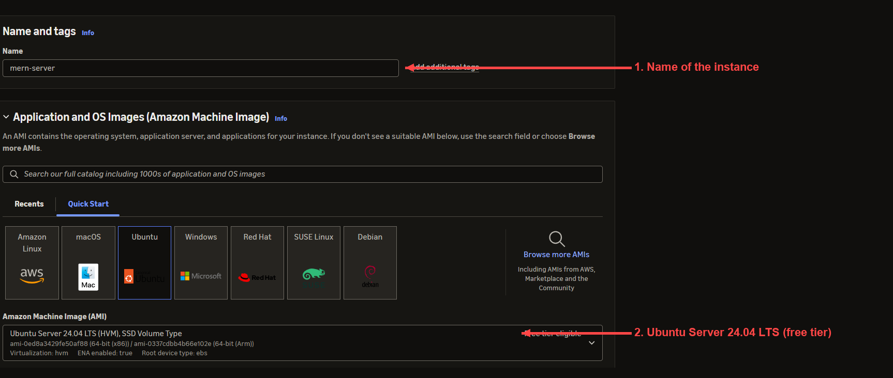
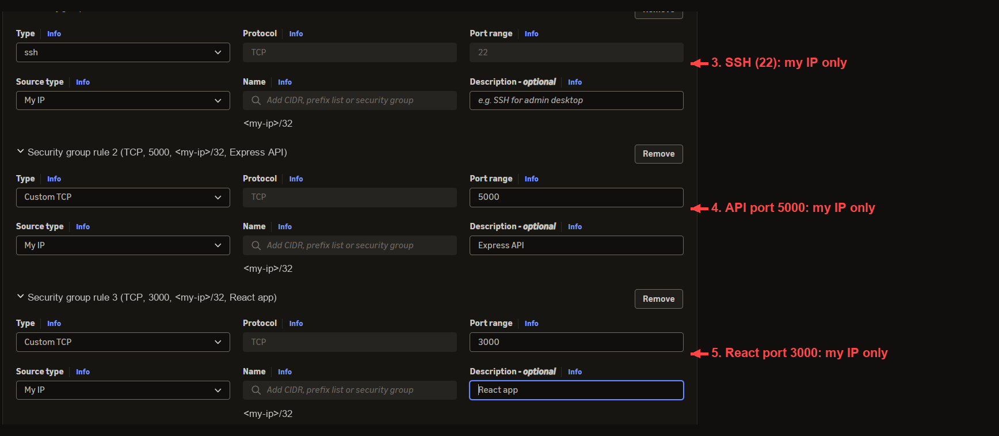
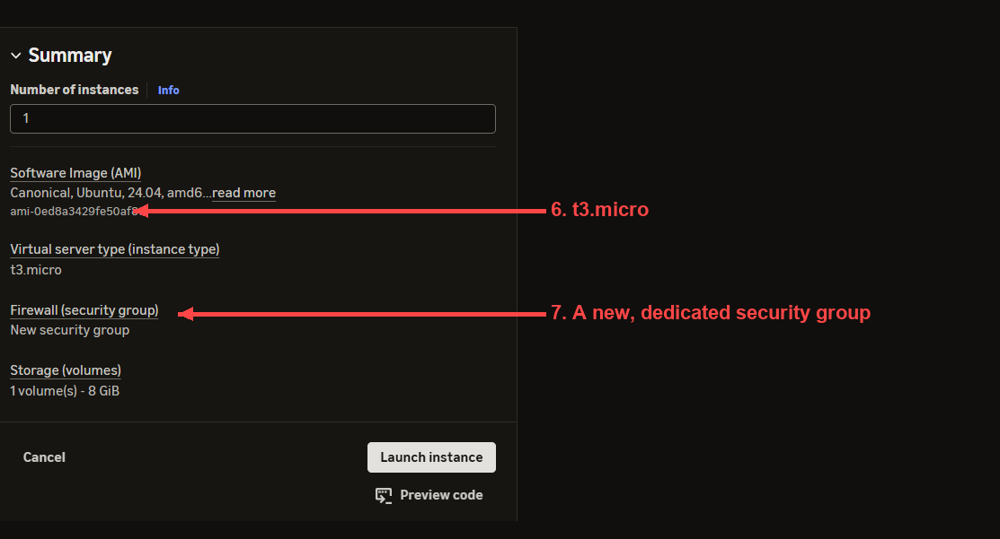
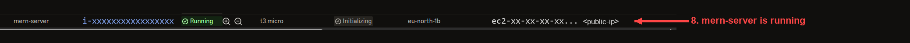
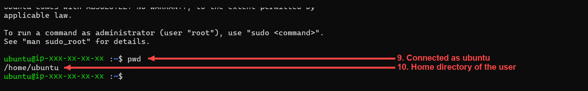

# Step 0: EC2 instance for the MERN project

A third Ubuntu 24.04 EC2 instance, `mern-server`, in the same region as the previous projects (Europe/Stockholm). I keep one instance per project and run one at a time to save my credits.

In *EC2* > *Launch instance*:
- **Name**: `mern-server`
- **Image**: Ubuntu Server 24.04 LTS (free tier eligible)
- **Type**: `t3.micro` (free tier eligible)
- **Key pair**: `lamp-key` (existing, kept outside the Git repository)
- **Default AWS service access**: left unticked: the instance does not need any AWS permission (least privilege)
- **Storage**: 8 GiB (default)



## Security group

I created a **new, dedicated security group** instead of reusing the one of the LAMP and LEMP servers: opening ports 5000 and 3000 there would also expose the two other servers.

| Port | Used for | Source |
|---|---|---|
| 22 | SSH | My IP |
| 5000 | Express API | My IP |
| 3000 | React app | My IP |

Every rule is limited to **my IP**, not to the whole Internet: the To-Do API has no authentication, so anyone could add or delete tasks if it was open to everyone. I did not open HTTP or HTTPS, because this project does not need them. The description of each rule says why it exists.





## Running instance and SSH connection



I connect from PowerShell with the key and the public IP of the instance (it changes each time I stop and start it):

```powershell
ssh -i lamp-key.pem ubuntu@<public-ip-address>
```



## Things to remember

- If my own IP changes, SSH (and the ports 5000 and 3000) stop working: I update the three rules to *My IP* again.
- I stop the instance at the end of each session.
