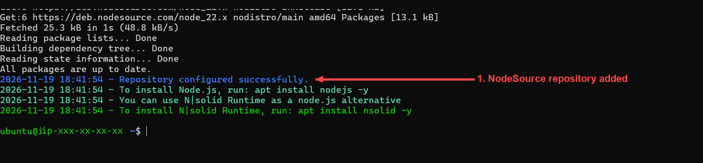
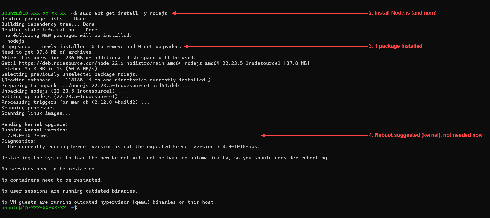
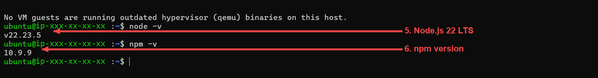

# Step 1: Install Node.js

Node.js is the runtime that runs JavaScript on the server, outside the browser. npm is its package manager (like `apt` for Ubuntu): it installs the Node modules and packages of the project.

## Update the system

```bash
sudo apt update && sudo apt upgrade -y
```

`apt update` refreshes the list of available packages, `apt upgrade -y` installs the updates (`-y` answers "yes" to the questions).

## Add the NodeSource repository

The course guide uses Node.js 18, which is no longer maintained. I use the **22 LTS** (long-term support) version instead, from the official NodeSource repository. The Ubuntu repositories do not provide a recent Node.js.

```bash
curl -fsSL https://deb.nodesource.com/setup_22.x | sudo -E bash -
```

- `curl -fsSL` downloads the setup script quietly (`-f` fails on HTTP errors, `-s` silent, `-S` still shows errors, `-L` follows redirects).
- `| sudo -E bash -` runs the script as administrator. This only adds the repository: nothing is installed yet.



## Install Node.js

```bash
sudo apt-get install -y nodejs
```

This installs both `node` and `npm`.



At the end, Ubuntu says a newer kernel is available and suggests a reboot. It is not needed for this project: Node.js works without it. A reboot would be useful later if I keep the server for a long time.

## Check the versions

```bash
node -v
npm -v
```



Node.js `v22.23.5` and npm `10.9.9` are installed.
