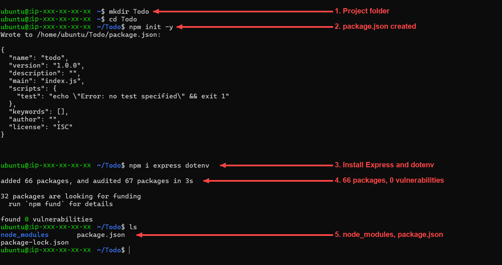
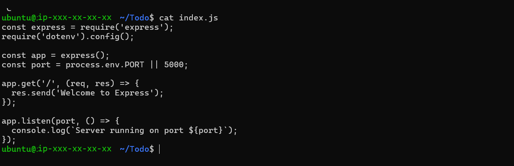
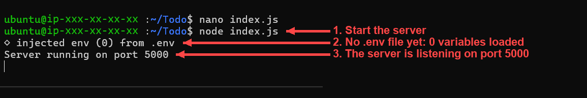
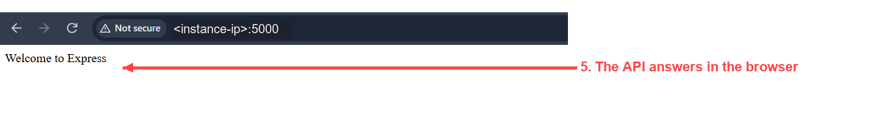
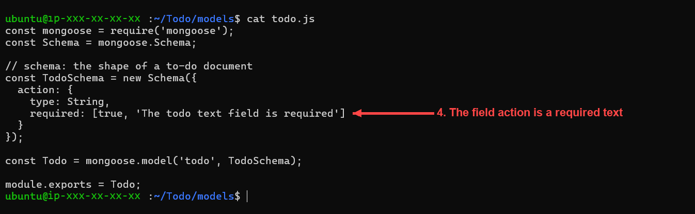
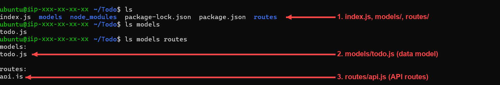

# Step 2: Backend with Express

The backend is the API of the To-Do application: it receives requests from the browser, reads or writes the database and sends back JSON.

## Create the project

```bash
mkdir Todo
cd Todo
npm init -y
npm install express dotenv
```

- `npm init -y` creates the `package.json` file, the identity card of the project (name, version, dependencies). The course guide answers the questions of `npm init` one by one: `-y` accepts all the default answers.
- **Express** is the web framework that handles the routes of the API.
- **dotenv** reads a `.env` file, so secrets (the database password) stay out of the code.



`npm install` created the `node_modules` folder (the installed packages, 66 of them) and `package-lock.json` (the exact versions). `node_modules` is never committed to GitHub: it can be recreated with `npm install`.

## First server

```bash
nano index.js
```

```javascript
const express = require('express');
require('dotenv').config();

const app = express();
const port = process.env.PORT || 5000;

app.get('/', (req, res) => {
  res.send('Welcome to Express');
});

app.listen(port, () => {
  console.log(`Server running on port ${port}`);
});
```

- `require('express')` loads Express, `require('dotenv').config()` loads the variables of the `.env` file.
- `process.env.PORT || 5000`: the port comes from the `.env` file if it exists, otherwise 5000.
- `app.get('/', ...)`: when someone requests `/`, the server answers "Welcome to Express".
- `app.listen(port, ...)`: the server listens on port 5000.

The course guide also adds a block that sends `Access-Control-Allow-Origin: *`, which lets any website call the API. I did not add it: with the proxy of the React application (later in the project), the browser only talks to its own server, so it is not needed, and it would be a wider opening than necessary.



```bash
node index.js
```



The message `injected env (0) from .env` comes from dotenv: there is no `.env` file yet, so it loaded 0 variables. It is not an error. I will create the file when I connect the database.

In the browser, `http://<public-ip-address>:5000` shows the answer. It works because the security group allows port 5000 from my IP.



I stop the server with `Ctrl+C`.

## Model and routes

The code is split in two parts: the **model** (the shape of a task in the database) and the **routes** (the URLs of the API).

```bash
npm install mongoose
mkdir models routes
```

**Mongoose** is the library that lets Node talk to MongoDB with models (a bit like PDO for MySQL, but for MongoDB).

`models/todo.js`:

```javascript
const mongoose = require('mongoose');
const Schema = mongoose.Schema;

// schema: the shape of a to-do document
const TodoSchema = new Schema({
  action: {
    type: String,
    required: [true, 'The todo text field is required']
  }
});

const Todo = mongoose.model('todo', TodoSchema);

module.exports = Todo;
```

- The **schema** describes a document: a text field `action`, which is required.
- `mongoose.model('todo', ...)` creates the `Todo` model, used to read, add and delete tasks.
- MongoDB itself has no fixed schema, but Mongoose adds one on the application side, so empty tasks are refused.



`routes/api.js`:

```javascript
const express = require('express');
const router = express.Router();
const Todo = require('../models/todo');

// list all tasks (only the id and the action are returned)
router.get('/todos', (req, res, next) => {
  Todo.find({}, 'action')
    .then(data => res.json(data))
    .catch(next);
});

// create a task
router.post('/todos', (req, res, next) => {
  if (req.body.action) {
    Todo.create(req.body)
      .then(data => res.json(data))
      .catch(next);
  } else {
    res.status(400).json({ error: 'The input field is empty' });
  }
});

// delete a task by its id
router.delete('/todos/:id', (req, res, next) => {
  Todo.findOneAndDelete({ _id: req.params.id })
    .then(data => res.json(data))
    .catch(next);
});

module.exports = router;
```

- Three actions: `GET` lists the tasks, `POST` creates one, `DELETE` removes one by its id.
- The calls to the database are promises: `.then(...)` sends the result, `.catch(next)` passes an error to Express.
- Difference with the course guide: when the field is empty, I answer with the status `400` (bad request) instead of a normal `200` with an error message. It is more correct for a REST API.


