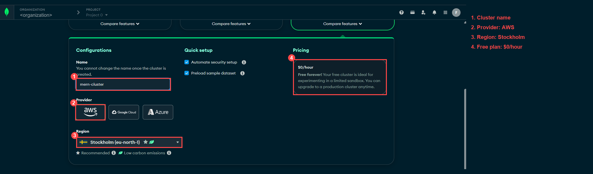
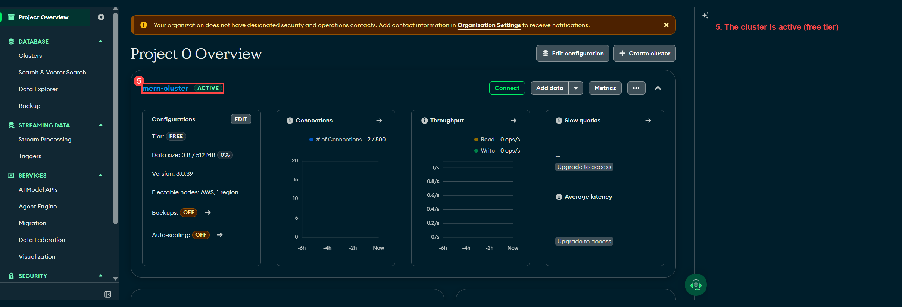
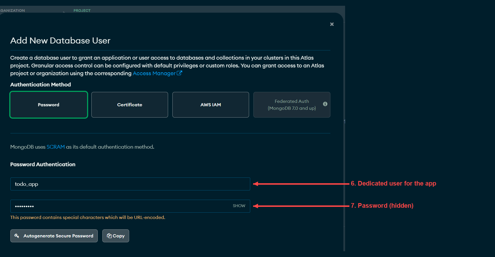
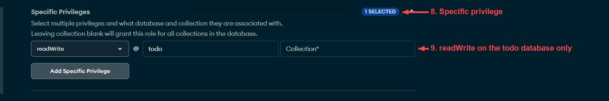
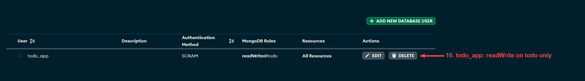
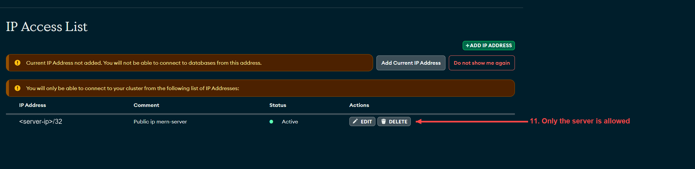
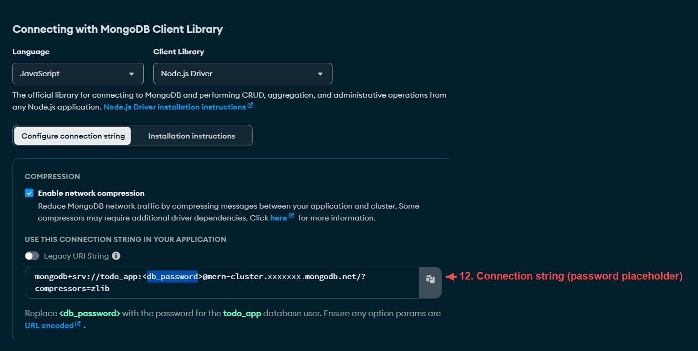
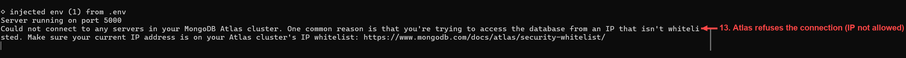
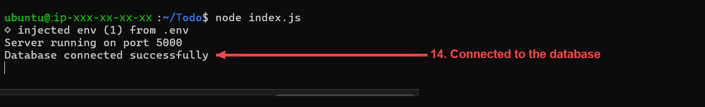

# Step 3: MongoDB Atlas database

The To-Do tasks are stored in MongoDB. Instead of installing and maintaining MongoDB on my EC2 instance, I use **MongoDB Atlas**, the managed MongoDB service, with its **free plan** (M0, 512 MB). The course guide uses mLab, which no longer exists: Atlas is its replacement.

## Cluster

In Atlas I created a free cluster: name `mern-cluster`, provider **AWS**, region **Stockholm (eu-north-1)**, the same region as my server.





## Database user (least privilege)

The application must not use an administrator account. In *Database Access* I created a dedicated user, `todo_app`, with password authentication and only one privilege: **`readWrite` on the `todo` database**. It cannot touch any other database, and it cannot manage the cluster. The password is generated and kept outside the repository.







## Network access: only my server

In *Network Access* I allow the **public IP of `mern-server`** and nothing else. The course guide allows access "from anywhere" (`0.0.0.0/0`), which is not secure: the database would be reachable by the whole Internet, protected only by its password.



The IP of the instance changes when I stop and start it, so I update this entry at the start of each session. The address Atlas sees is the one of the server, which I can check from the server itself:

```bash
curl -s https://checkip.amazonaws.com
```

## Connection string and the `.env` file

In *Connect > Drivers*, Atlas gives the beginning of the connection string, with a placeholder for the password:



I put the full string in a `.env` file **on the server**, in the `Todo` folder. It is never copied to GitHub: `.env` is in the `.gitignore` of the repository, and the code of the application stays on the server.

```bash
nano .env
chmod 600 .env
```

The file contains one line:

```
DB=mongodb+srv://todo_app:<my-password>@<cluster-address>/todo?retryWrites=true&w=majority
```

- `<my-password>` is the password of `todo_app`. If it contains special characters, they must be **URL-encoded** (`#` becomes `%23`, `@` becomes `%40`...). A `#` is also the start of a comment in a `.env` file, so it can never be written as it is.
- `/todo` is the **name of the database**, just before the `?`. Without it, Mongoose uses a database called `test`, where my user has no rights.
- `chmod 600` makes the file readable by me only.

To check the file without showing the password, I replace it with `xxx` at display time:

```bash
sed 's/\(\/\/[^:]*:\)[^@]*@/\1xxx@/' .env
```

## Connecting `index.js` to the database

```javascript
const express = require('express');
const mongoose = require('mongoose');
const routes = require('./routes/api');
require('dotenv').config();

const app = express();
const port = process.env.PORT || 5000;

// connect to the database
mongoose.connect(process.env.DB)
  .then(() => console.log('Database connected successfully'))
  .catch(err => console.error(err.message));

app.use(express.json());      // read JSON bodies (POST requests)
app.use('/api', routes);      // all the routes start with /api

// generic error handler: no technical details are sent to the client
app.use((err, req, res, next) => {
  console.error(err.message);
  res.status(500).json({ error: 'Server error' });
});

app.listen(port, () => {
  console.log(`Server running on port ${port}`);
});
```

- `express.json()` replaces `body-parser` of the course guide (it is built into Express), and the old `useNewUrlParser` options are no longer needed.
- The error handler sends `Server error` to the client and writes the real message only in the server console, so the API does not reveal internal details.
- I removed the `Welcome to Express` page: opening `/` now answers `Cannot GET /`, which is normal. The API lives under `/api`.

My first attempt failed: Atlas refused the connection, because the IP list contained the IP of my PC instead of the one of the server.



After fixing the IP and the `.env` file:

```bash
node index.js
```



The database `todo` does not exist yet in Atlas: MongoDB creates the database and the `todos` collection **on the first write**. The name of the collection comes from the model: `mongoose.model('todo', ...)` becomes `todos`.
