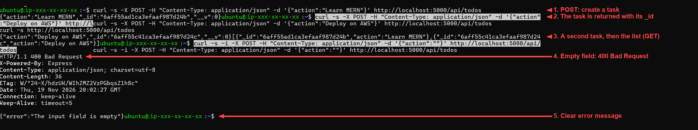
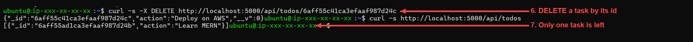
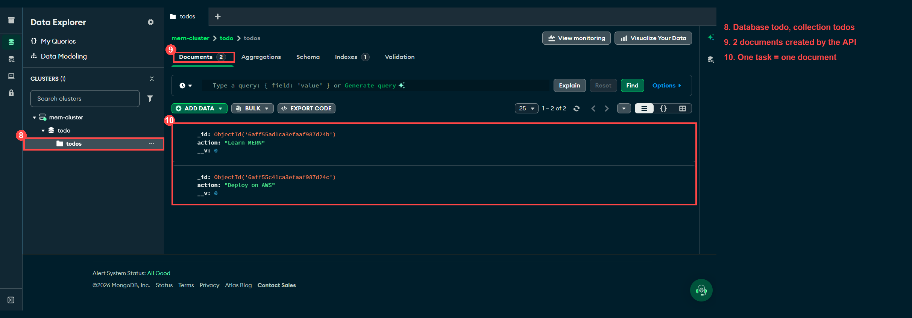
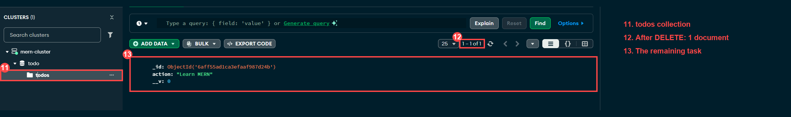

# Step 4: Testing the API with curl

The frontend does not exist yet, so I test the API directly from the server with `curl`, a command-line HTTP client. The course guide uses Postman; `curl` does the same job and needs no installation. With the server running (`node index.js`), I send the requests to `http://localhost:5000`.

## Create tasks (POST) and list them (GET)

```bash
curl -s -X POST -H "Content-Type: application/json" -d '{"action":"Learn MERN"}' http://localhost:5000/api/todos
curl -s -X POST -H "Content-Type: application/json" -d '{"action":"Deploy on AWS"}' http://localhost:5000/api/todos
curl -s http://localhost:5000/api/todos
```

| Option | Role |
|---|---|
| `-s` | silent mode: no progress bar |
| `-X POST` | chooses the HTTP method (`GET` is the default) |
| `-H "Content-Type: application/json"` | tells the server that the body is JSON. Without it, `express.json()` does not read it |
| `-d '...'` | the body of the request: the data I send |
| `-i` | also shows the HTTP status line and the headers of the response |

Each answer contains the new task with its `_id`, generated by MongoDB, and `__v`, a version number added by Mongoose.

## Validation: an empty task is refused

```bash
curl -s -i -X POST -H "Content-Type: application/json" -d '{"action":""}' http://localhost:5000/api/todos
```

The answer is `HTTP/1.1 400 Bad Request` and `{"error":"The input field is empty"}`: the route checks the data before saving it.



## Delete a task (DELETE)

```bash
curl -s -X DELETE http://localhost:5000/api/todos/<id>
curl -s http://localhost:5000/api/todos
```

`<id>` is the `_id` of the task. The first command returns the deleted task, the second one confirms that only one task is left.



## Checking in Atlas

In *Data Explorer*, the database `todo` and the collection `todos` now exist: each task is a document.



After the `DELETE`, only one document is left:



The backend is complete: the three routes work and the data is stored in MongoDB Atlas.

## Problem I met: `{"error":"Server error"}`

After connecting the database, `GET /api/todos` answered `{"error":"Server error"}` (status 500) even though the server said `Database connected successfully`. I searched step by step:

1. I checked the Atlas side: the IP list, the user and its role were correct, and a small script confirmed that I could connect and read the collection (`connected to todo`, `documents: 0`). So the problem was not Atlas.
2. The server console did not print any error for my request. This meant that the answer did not come from the server I had just started: **an older `node index.js`, started before I fixed the `.env` file, was still running and kept answering on port 5000.**
3. I stopped every copy, started a new one with its messages saved in a file, and sent the request again:

```bash
pgrep -a node                              # lists the running Node processes
pkill -f "node index.js"                   # stops them all
(node index.js > /tmp/server.log 2>&1 &)   # starts the server in the background, messages in a file
sleep 3; curl -s http://localhost:5000/api/todos; echo; cat /tmp/server.log
```

The answer was `[]`: the API worked.

What I learned:
- Node reads the `.env` file **only at startup**: after changing it, I restart the server.
- Before testing, I check that **only one** `node index.js` is running (`pgrep -a node`).
- A generic error message on the client side is good for security, but I need to look at the server log to find the real cause.
- The connection string must contain the name of the database (`/todo`), otherwise Mongoose works on a database where the user has no rights.
