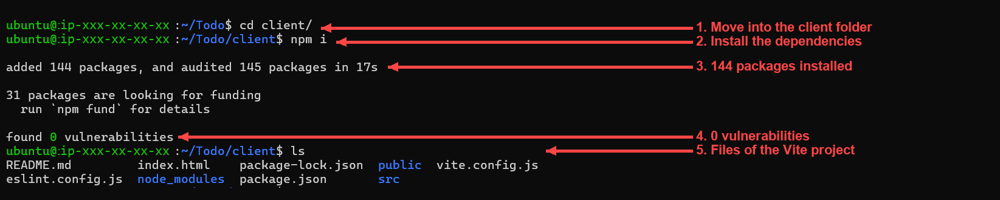
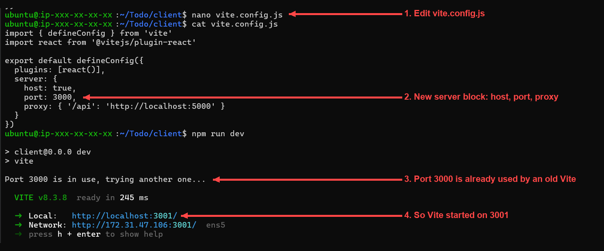
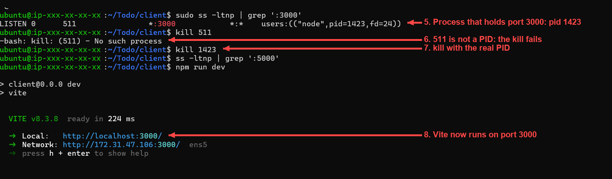
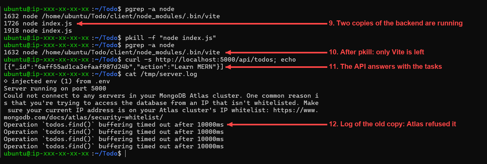
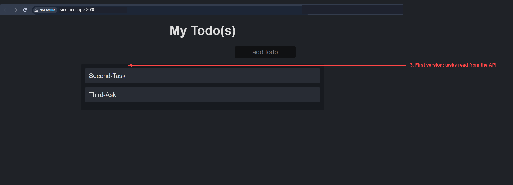
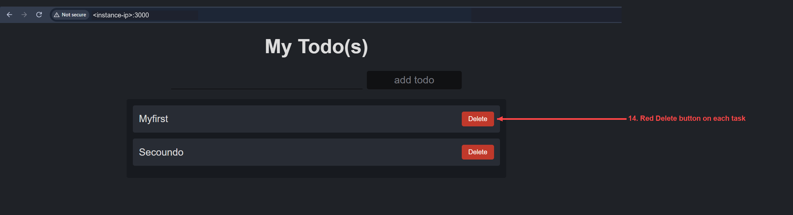
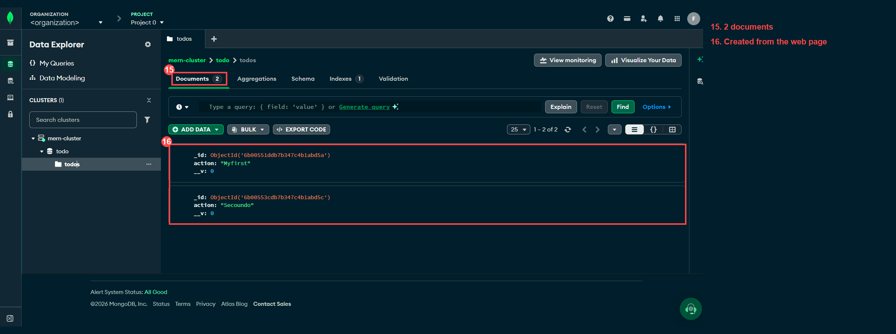

# Step 5: React frontend

The frontend is the web page of the To-Do application: it runs in the browser and talks to my API.

## Create the project with Vite

The course guide uses `create-react-app`, which is no longer maintained. I use **Vite**, the current tool to start a React project: it is faster, and lighter on a small `t3.micro` instance.

```bash
cd ~/Todo
npm create vite@latest client -- --template react
cd client
npm install
```

- `npm create vite@latest client` creates a `client` folder from a template.
- `-- --template react` chooses the React template (JavaScript).
- I answered "No" to the experimental option and to "install and start now", so I could run each step myself.



## Configuration: reachable from my PC, and a proxy to the API

By default, the Vite development server only listens on `localhost` (the server itself) and uses the port 5173. I edited `vite.config.js`:

```javascript
import { defineConfig } from 'vite'
import react from '@vitejs/plugin-react'

export default defineConfig({
  plugins: [react()],
  server: {
    host: true,                                 // listen on all network interfaces
    port: 3000,                                 // the port opened in my security group
    proxy: { '/api': 'http://localhost:5000' }  // forward the API calls to the backend
  }
})
```

- `host: true` makes the server reachable from my browser, not only from the instance itself.
- `port: 3000` matches the rule of my security group (my IP only).
- The **proxy** forwards every request that starts with `/api` to the backend on port 5000. The browser only talks to port 3000: it never calls port 5000 directly, so there is no cross-origin (CORS) problem. This is why I did not need the `Access-Control-Allow-Origin: *` block of the course guide.

## Problems I met

**1. The page did not load in my browser.** The first `npm run dev` showed `Local: http://localhost:5173/` and `Network: use --host to expose`: my changes of `vite.config.js` had not been saved, so Vite was still using its defaults. I edited and saved the file, checked it with `cat vite.config.js`, and restarted.

**2. `Port 3000 is in use, trying another one...`.** The first Vite was still running in the background and held the port 3000. The new one started on 3001, which my security group does not open.



To find who holds the port and stop it:

```bash
sudo ss -ltnp | grep ':3000'    # lists the listening sockets with their process
kill <PID>                      # stops one process by its number
pkill -f "node index.js"        # stops every process whose command line contains this text
pgrep -a node                   # lists the running Node processes with their PID
```

My first `kill` failed (`No such process`): I used `511`, which is not the PID but the size of the connection queue, in another column of `ss`. The PID is in `users:(("node",pid=1423,...))`. `kill 1423` worked, and Vite restarted on port 3000.



`kill` targets one process by its number, `pkill` targets processes by name. Before starting a server, I check that no copy is already running: I also found two copies of the backend (the same problem as in the previous step), and the old one still wrote errors in its log, because Atlas refused its connection.



## Commands to find and stop processes

I used these commands several times in this project (backend, Vite). I keep them here as a reference.

**Which program uses which port?**

```bash
sudo ss -ltnp
sudo ss -ltnp | grep ':3000'
```

| Option | Role |
|---|---|
| `ss` | shows the network sockets (the modern replacement of `netstat`) |
| `-l` | only the sockets that are **listening** (waiting for connections) |
| `-t` | only **TCP** |
| `-n` | shows **numbers** (ports), not names (`3000` instead of a service name) |
| `-p` | shows the **process** that owns the socket (needs `sudo` to see the processes of other users) |
| `\| grep ':3000'` | keeps only the lines that contain `:3000` |

In the result, `users:(("node",pid=1423,fd=24))` gives the program name and its **PID** (process number). If nothing is printed, nobody listens on this port: for example, an empty answer for `:5000` means that the backend is not running.

**Which processes are running?**

```bash
pgrep -a node
```

- `pgrep` searches the running processes by name.
- `-a` shows the full command line (not only the PID), so I can tell the backend (`node index.js`) from Vite (`node .../vite`).
- Nothing printed means that no Node process is running.

**Stop a process**

```bash
kill 1423                       # by PID
pkill vite                      # by name
pkill -f "node index.js"        # by full command line
```

| Command | Target |
|---|---|
| `kill <PID>` | **one** process, by its number (`kill` does not accept a name) |
| `pkill <name>` | every process whose **name** matches |
| `pkill -f "<text>"` | every process whose **full command line** contains the text (needed here, because both the backend and Vite are called `node`) |

`kill` sends the signal `SIGTERM` ("please stop"): the program stops cleanly. If a process ignores it, `kill -9 <PID>` forces it, but I use it as a last resort because the program cannot clean up.

**My routine before starting a server**

```bash
pgrep -a node                   # is a copy already running?
pkill -f "node index.js"        # if yes, stop the old backend
sudo ss -ltnp | grep -E ':3000|:5000'   # are my ports free?
```

**Start the backend in the background and keep its messages**

```bash
(node index.js > /tmp/server.log 2>&1 &)
cat /tmp/server.log
```

- `( ... &)` runs the command in the background, so the terminal stays free.
- `> /tmp/server.log` saves what the program prints in a file, and `2>&1` sends the error messages (stream 2) to the same place as the normal output (stream 1).
- `cat /tmp/server.log` shows the messages later, including the errors.

## React components

The application is split in components, in `src/components`:

`Input.jsx`: the field to add a task. It sends a `POST` to the API, then asks the list to reload.

```jsx
import { useState } from 'react'

function Input({ getTodos }) {
  const [action, setAction] = useState('')

  const addTodo = () => {
    if (!action.trim()) return
    fetch('/api/todos', {
      method: 'POST',
      headers: { 'Content-Type': 'application/json' },
      body: JSON.stringify({ action })
    })
      .then(() => {
        setAction('')
        getTodos()
      })
      .catch(err => console.log(err))
  }

  return (
    <div>
      <input type="text" value={action} onChange={e => setAction(e.target.value)} />
      <button onClick={addTodo}>add todo</button>
    </div>
  )
}

export default Input
```

`ListTodo.jsx`: displays the tasks. Each task has a red **Delete** button.

```jsx
function ListTodo({ todos, deleteTodo }) {
  return (
    <ul>
      {todos.length > 0 ? (
        todos.map(todo => (
          <li key={todo._id}>
            <span>{todo.action}</span>
            <button className="delete" onClick={() => deleteTodo(todo._id)}>
              Delete
            </button>
          </li>
        ))
      ) : (
        <li>No todo(s) left</li>
      )}
    </ul>
  )
}

export default ListTodo
```

`Todo.jsx`: the main component. It reads the tasks from the API when the page loads and deletes a task on request.

```jsx
import { useState, useEffect } from 'react'
import Input from './Input'
import ListTodo from './ListTodo'

function Todo() {
  const [todos, setTodos] = useState([])

  const getTodos = () => {
    fetch('/api/todos')
      .then(res => res.json())
      .then(data => setTodos(data))
      .catch(err => console.log(err))
  }

  const deleteTodo = id => {
    fetch(`/api/todos/${id}`, { method: 'DELETE' })
      .then(() => getTodos())
      .catch(err => console.log(err))
  }

  useEffect(() => {
    getTodos()
  }, [])

  return (
    <div>
      <h1>My Todo(s)</h1>
      <Input getTodos={getTodos} />
      <ListTodo todos={todos} deleteTodo={deleteTodo} />
    </div>
  )
}

export default Todo
```

`App.jsx` replaces the example page of Vite with the `Todo` component:

```jsx
import Todo from './components/Todo'
import './App.css'

function App() {
  return (
    <div className="App">
      <Todo />
    </div>
  )
}

export default App
```

- The course guide uses class components and the `axios` library. I use function components with hooks (`useState` for the data of the component, `useEffect` to load the tasks once when the page opens) and the built-in `fetch`, so there is no extra package to install.
- The requests start with `/api`, so the Vite proxy sends them to the backend.
- I replaced the example styles of Vite in `index.css` and wrote my own `App.css` (dark background, task cards). I added a red style for the delete button:

```css
li {
  display: flex;
  justify-content: space-between;
  align-items: center;
  cursor: default;
}

li button.delete {
  width: auto;
  height: 36px;
  padding: 0 16px;
  margin-left: 15px;
  font-size: 1rem;
  background: #c0392b;
  color: #fff;
}

li button.delete:hover {
  background: #e74c3c;
}
```

`li button.delete` is more specific than the general `button` rule, so only the delete buttons are red and the "add todo" button keeps its own style.

## Result

My first version deleted a task when I clicked on it. It worked, but it was not obvious for a user, so I replaced it by a visible button.





The tasks I add in the page are real documents in MongoDB Atlas:



The full MERN stack works: React (browser) calls Express (API), which reads and writes MongoDB Atlas.
