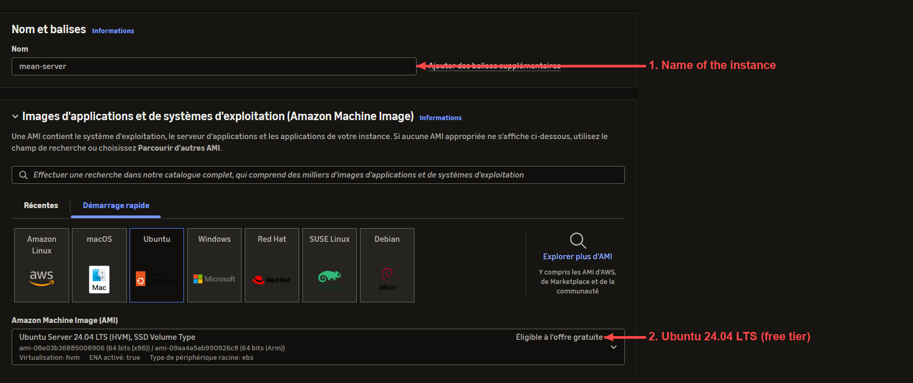
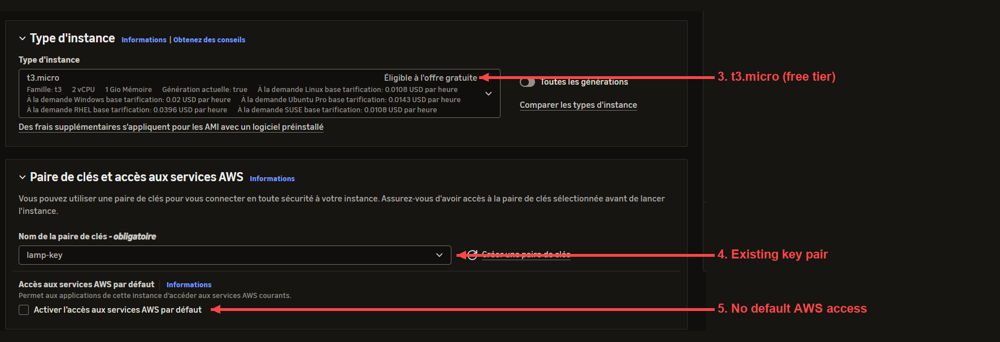
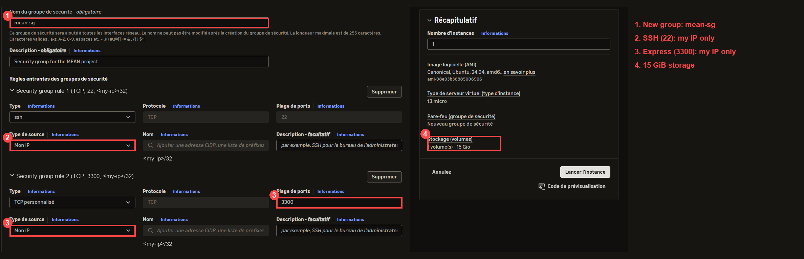
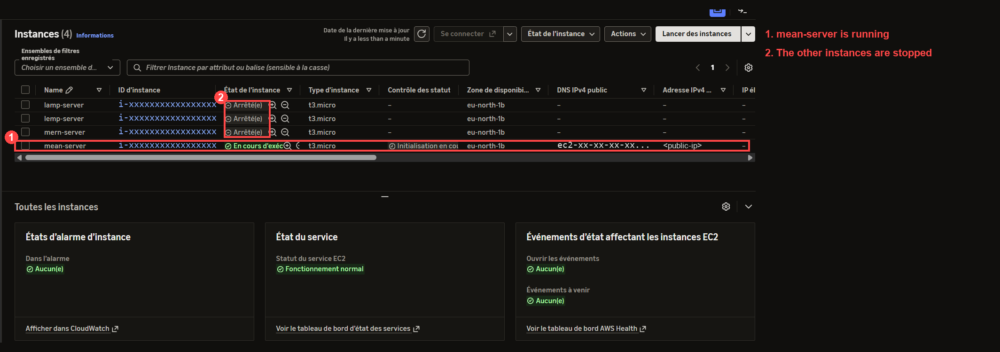

# Step 0: EC2 instance for the MEAN project

I use a new instance, `mean-server`, with its own security group, so the project can be cleaned up alone at the end. The course guide opens ports 22, 80, 443 and 5000 to the whole Internet. I open only what the project needs, and only from my IP.

## Launch the instance

| Setting | Value |
|---|---|
| Name | `mean-server` |
| Region | Stockholm (`eu-north-1`) |
| AMI | Ubuntu Server 24.04 LTS (free tier eligible) |
| Instance type | `t3.micro` (free tier) |
| Key pair | `lamp-key` (the one I already have) |
| Storage | 15 GiB (MongoDB and Angular need more room than the default) |
| AWS access by default | not enabled: the instance does not need any AWS permission |





## Security group: `mean-sg`

I created a new group instead of reusing the one of the MERN project (the wizard proposes its name again: I changed it to `mean-sg`).

| Port | Use | Source |
|---|---|---|
| 22 (SSH) | my connection | my IP only |
| 3300 (custom TCP) | the Express application | my IP only |

Ports that I did **not** open:
- **27017 (MongoDB)**: the database stays reachable only from the server itself.
- **80, 443, 5000** from the guide: not needed here. The Angular build is served by Express on port 3300, so there is no separate frontend port either.



The instance is the only one running: `lamp-server`, `lemp-server` and `mern-server` are stopped.



## Connect

```bash
ssh -i lamp-key.pem ubuntu@<public-ip>
```

The public IP changes every time I stop and start the instance, and my own IP can change too. When the connection times out, I check the public IP of the instance and the *My IP* source of the two rules of `mean-sg`.
