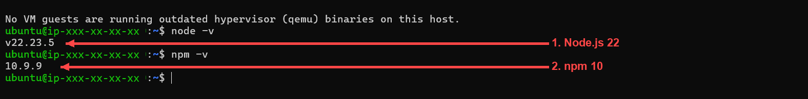
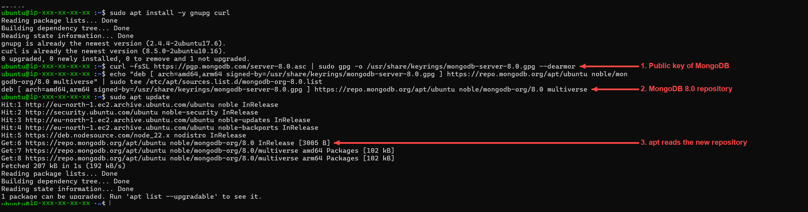
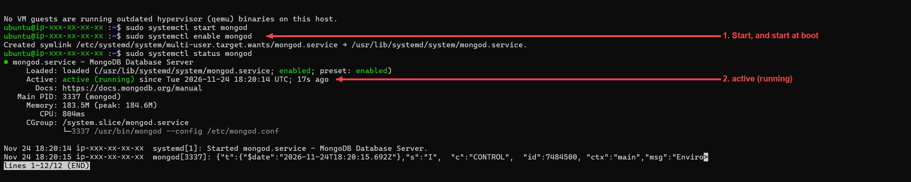
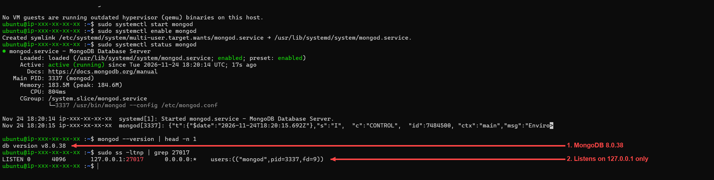
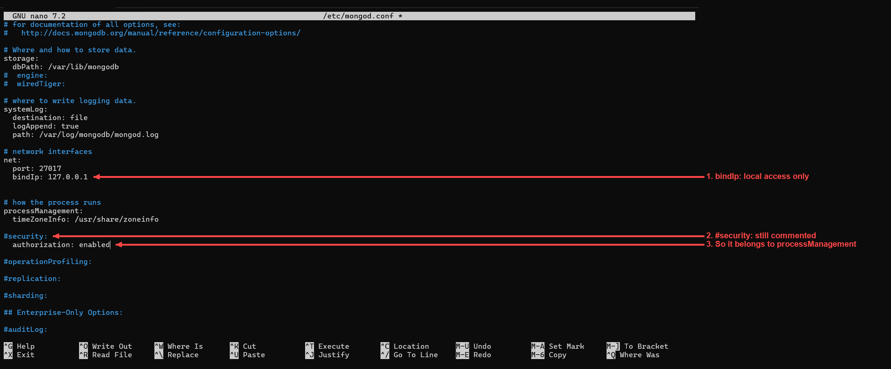
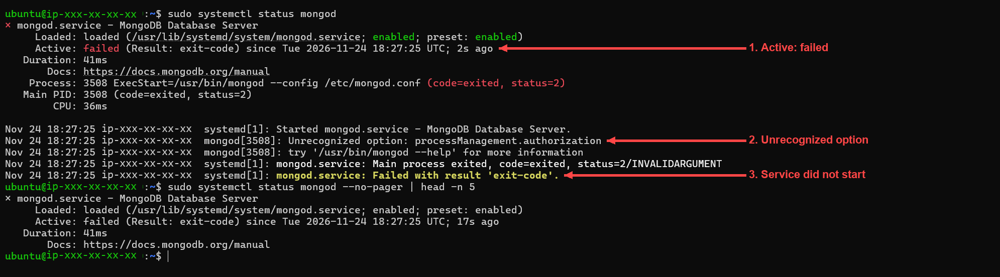
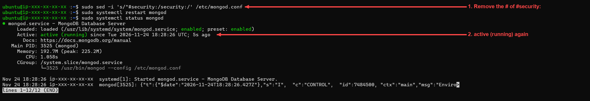
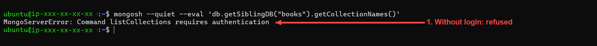
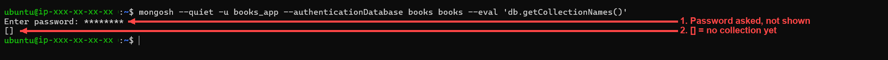

# Step 1 and 2: Node.js and MongoDB

## Node.js

The guide installs Node 12, which is no longer maintained. I install Node 22, like in the MERN project.

```bash
sudo apt update && sudo apt upgrade -y
curl -fsSL https://deb.nodesource.com/setup_22.x | sudo -E bash -
sudo apt install -y nodejs
node -v && npm -v
```



## Install MongoDB on the server

For the MERN project I used MongoDB Atlas. This time the guide installs MongoDB on the instance itself, so I do it once to learn how it works.

The guide uses MongoDB 7.0 with the repository of Ubuntu 22.04 (`jammy`). My server is Ubuntu 24.04 (`noble`), so I use **MongoDB 8.0**, which has its own repository for `noble`.

```bash
sudo apt install -y gnupg curl
curl -fsSL https://pgp.mongodb.com/server-8.0.asc | sudo gpg -o /usr/share/keyrings/mongodb-server-8.0.gpg --dearmor
echo "deb [ arch=amd64,arm64 signed-by=/usr/share/keyrings/mongodb-server-8.0.gpg ] https://repo.mongodb.org/apt/ubuntu noble/mongodb-org/8.0 multiverse" | sudo tee /etc/apt/sources.list.d/mongodb-org-8.0.list
sudo apt update
sudo apt install -y mongodb-org
```

| Command | Role |
|---|---|
| `curl ... server-8.0.asc \| sudo gpg --dearmor` | imports the public key of MongoDB, so `apt` can check that the packages are genuine |
| `echo "deb [...] ..." \| sudo tee ...` | adds the MongoDB repository to the list of sources |
| `sudo apt update` | reads the new repository |
| `sudo apt install -y mongodb-org` | installs the server, the shell (`mongosh`) and the tools |



Start the service, and start it at every boot:

```bash
sudo systemctl start mongod
sudo systemctl enable mongod
sudo systemctl status mongod
```



I check the version and the network address:

```bash
mongod --version | head -n 1
sudo ss -ltnp | grep 27017
```

MongoDB listens on **`127.0.0.1:27017`**: only programs on the server can connect. Nobody on the Internet can reach it, and the port is not open in the security group either.



## Secure MongoDB: a user with the least privilege

A MongoDB installed locally has **no authentication** by default: any program on the server can read and delete everything. Like in the MERN project, the application gets its own user, with the minimum rights: `readWrite` on the `books` database only.

```bash
mongosh
```

```javascript
use books
db.createUser({ user: "books_app", pwd: passwordPrompt(), roles: [{ role: "readWrite", db: "books" }] })
```

`passwordPrompt()` asks the password without showing it, so it appears neither on the screen nor in the history of commands. The user is created in the `books` database, so this is also the database where it logs in (`--authenticationDatabase books`).

Then I turn on the authentication in `/etc/mongod.conf`:

```yaml
security:
  authorization: enabled
```

and restart: `sudo systemctl restart mongod`.

### Problem I met: MongoDB did not start

My first attempt failed. I had added the line `authorization: enabled`, but I had left the `#` in front of `security:`.



`#security:` is a comment, so `authorization: enabled` ended up under the block above it, `processManagement:`. MongoDB refused to start:



The fix is to remove the `#`, then restart and check:

```bash
sudo sed -i 's/^#security:/security:/' /etc/mongod.conf
sudo systemctl restart mongod
sudo systemctl status mongod
```



### Check the authentication

Without a login, a read is refused:

```bash
mongosh --quiet --eval 'db.getSiblingDB("books").getCollectionNames()'
```



With the application user, it works (the password is asked and not shown). The answer is `[]` because the database is still empty:

```bash
mongosh --quiet -u books_app --authenticationDatabase books books --eval 'db.getCollectionNames()'
```



What I learned:
- In a YAML file, a `#` makes the whole line a comment, and the indentation decides which block a line belongs to.
- `systemctl status` and its last log lines give the real reason why a service did not start.
- Even on a local database, I create a dedicated user with the minimum rights and turn on the authentication.
