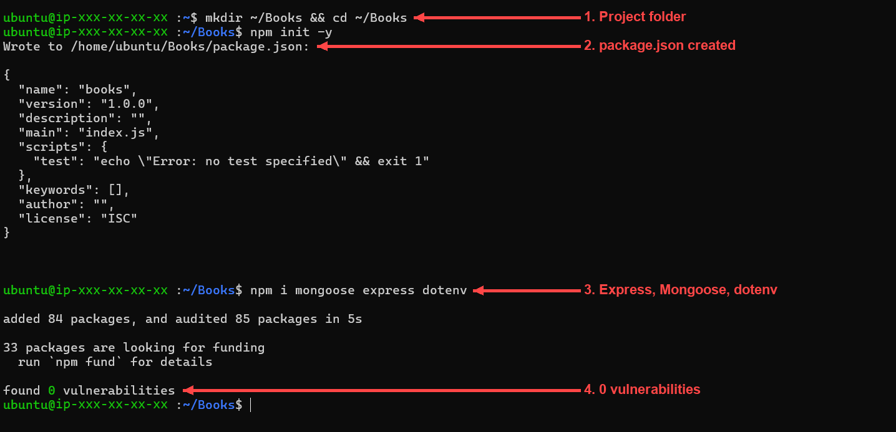
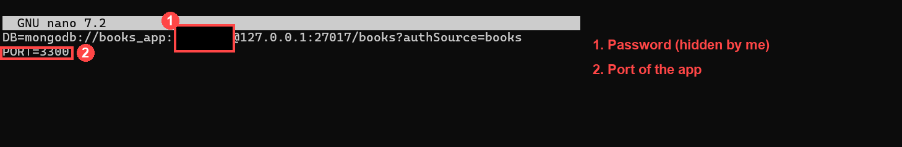
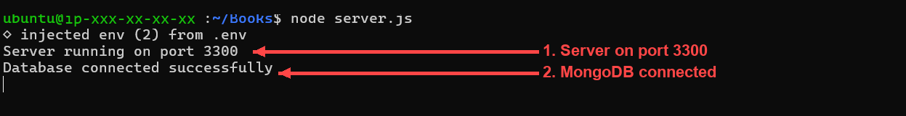
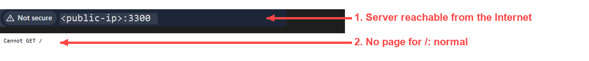
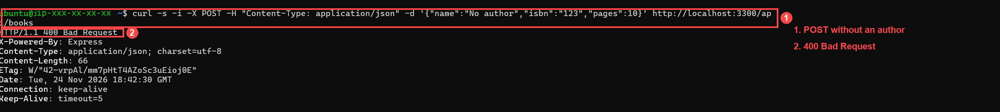
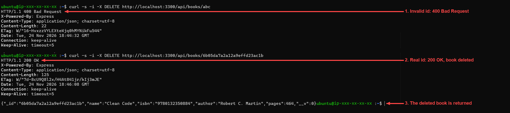
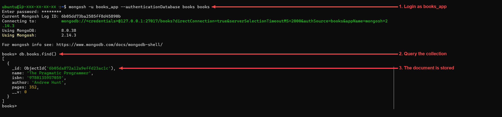

# Step 3: Express backend with Mongoose

The backend is the API of the Book Register: it receives the requests of the browser, reads and writes the books in MongoDB, and answers in JSON.

## Project and packages

```bash
mkdir ~/Books && cd ~/Books
npm init -y
npm i mongoose express dotenv
```

The guide uses `sudo npm install` and `body-parser`. I install the packages as my own user (with `sudo`, the files would belong to `root`), and I do not need `body-parser`: `express.json()` is built into Express.



## The connection string: `.env`

```bash
mkdir -p apps/models
nano .env
chmod 600 .env
```

```
DB=mongodb://books_app:<my-password>@127.0.0.1:27017/books?authSource=books
PORT=3300
```

- The guide writes the address in the code (`mongodb://localhost:27017/test`). I keep it in a `.env` file that is never copied to GitHub (`.env` is in the `.gitignore`).
- `/books` is the name of the database, and `authSource=books` tells MongoDB where the user `books_app` was created.
- `chmod 600`: only I can read the file.



## The model: `apps/models/book.js`

```javascript
const mongoose = require('mongoose');

const BookSchema = new mongoose.Schema({
  name: { type: String, required: [true, 'The name is required'] },
  isbn: { type: String, required: [true, 'The ISBN is required'], index: true },
  author: { type: String, required: [true, 'The author is required'] },
  pages: { type: Number, required: [true, 'The number of pages is required'], min: 1 }
});

module.exports = mongoose.model('Book', BookSchema);
```

The model describes a book and its rules: every field is required, and a book has at least one page. Mongoose stores the books in the collection `books`.

## The routes: `apps/routes.js`

```javascript
const express = require('express');
const Book = require('./models/book');

const router = express.Router();

// list the books
router.get('/', async (req, res, next) => {
  try {
    res.json(await Book.find());
  } catch (err) {
    next(err);
  }
});

// add a book (only the 4 expected fields are used)
router.post('/', async (req, res, next) => {
  try {
    const { name, isbn, author, pages } = req.body;
    const book = await Book.create({ name, isbn, author, pages });
    res.status(201).json(book);
  } catch (err) {
    if (err.name === 'ValidationError') return res.status(400).json({ error: err.message });
    next(err);
  }
});

// delete a book by its _id
router.delete('/:id', async (req, res, next) => {
  try {
    const book = await Book.findByIdAndDelete(req.params.id);
    if (!book) return res.status(404).json({ error: 'Book not found' });
    res.json(book);
  } catch (err) {
    if (err.name === 'CastError') return res.status(400).json({ error: 'Invalid id' });
    next(err);
  }
});

module.exports = router;
```

| Method and URL | Action | Answer |
|---|---|---|
| `GET /api/books` | list the books | `200` and the list |
| `POST /api/books` | add a book | `201` and the book, or `400` if a field is missing |
| `DELETE /api/books/:id` | delete a book | `200` and the deleted book, `404` if it does not exist, `400` if the id is invalid |

Differences with the guide:
- The URL names the resource (`/api/books`) and the HTTP method is the action. The guide uses `/book`.
- The guide deletes by ISBN with a query string. I delete by `_id`, which is unique.
- The guide uses `throw err` inside callbacks, which would stop the server. I use `async` / `await` and send the error to Express (`next(err)`).
- Only the four expected fields are read from the request, so a client cannot add other fields.

## The server: `server.js`

```javascript
require('dotenv').config();
const express = require('express');
const mongoose = require('mongoose');
const path = require('path');
const routes = require('./apps/routes');

const app = express();
const port = process.env.PORT || 3300;

mongoose.connect(process.env.DB)
  .then(() => console.log('Database connected successfully'))
  .catch(err => console.error(err.message));

app.use(express.json());
app.use('/api/books', routes);
app.use(express.static(path.join(__dirname, 'public')));   // the Angular build will go here

// generic error handler: no technical details are sent to the client
app.use((err, req, res, next) => {
  console.error(err.message);
  res.status(500).json({ error: 'Server error' });
});

app.listen(port, () => {
  console.log(`Server running on port ${port}`);
});
```

Before starting, I check that no old copy is running (`pgrep -a node`), then:

```bash
node server.js
```



From my browser, `http://<public-ip>:3300` answers `Cannot GET /`. This is normal: the API lives under `/api/books`, and there is no page yet.



## Tests with curl

In a second terminal, on the server:

```bash
# list the books (empty at first)
curl -s http://localhost:3300/api/books

# add a book
curl -s -X POST -H "Content-Type: application/json" -d '{"name":"Clean Code","isbn":"9780132350884","author":"Robert C. Martin","pages":464}' http://localhost:3300/api/books

# a book without an author must be refused
curl -s -i -X POST -H "Content-Type: application/json" -d '{"name":"No author","isbn":"123","pages":10}' http://localhost:3300/api/books
```

The book without an author is refused with `400 Bad Request`.



```bash
# delete a book (an invalid id, then a real one)
curl -s -i -X DELETE http://localhost:3300/api/books/abc
curl -s -i -X DELETE http://localhost:3300/api/books/<id>
```



Then I check the data directly in MongoDB, with the application user. The deleted book is gone and the other one is stored:

```bash
mongosh -u books_app --authenticationDatabase books books
```
```javascript
db.books.find()
```



The backend is complete: three routes, validation, and data stored in MongoDB.
