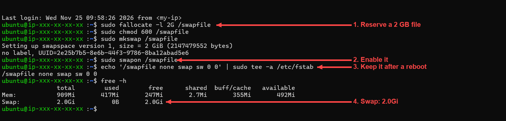
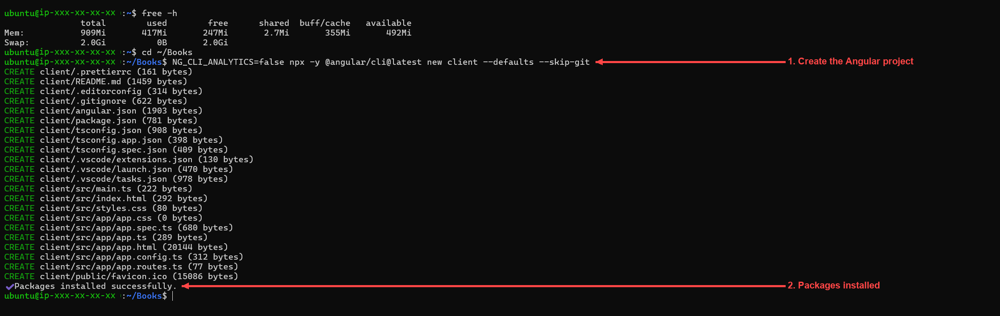
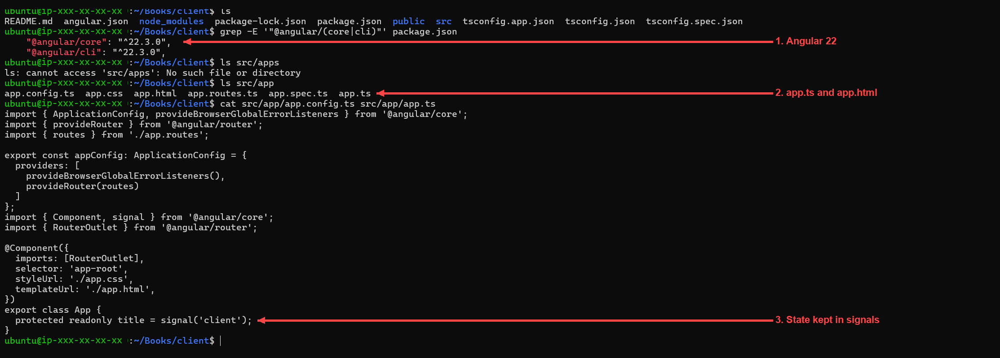
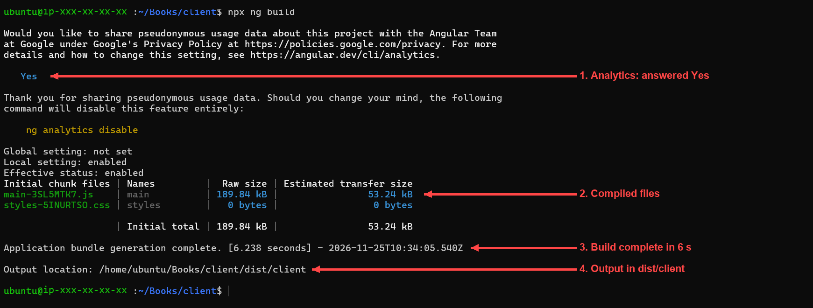
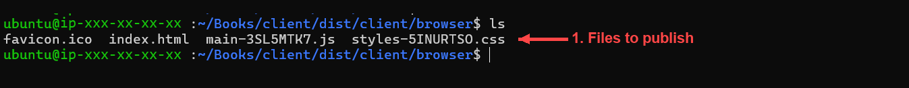
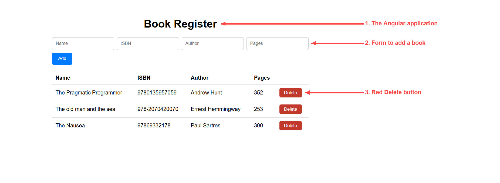
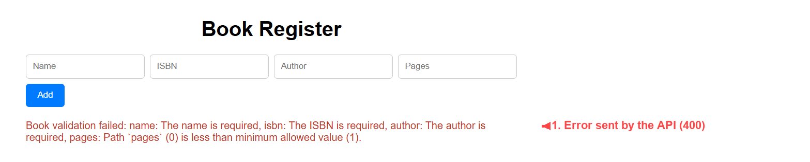
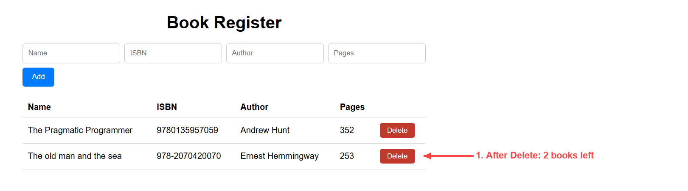
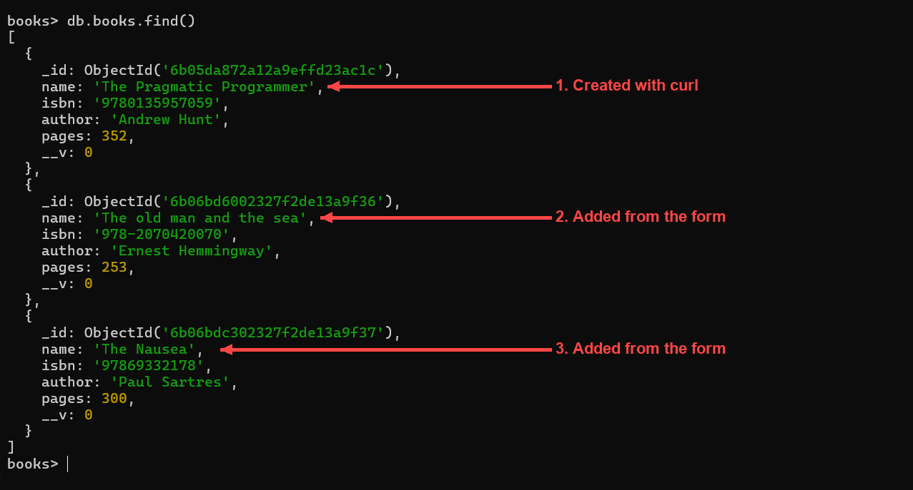

# Step 4: Angular frontend

The frontend is the web page of the Book Register. The guide uses **AngularJS 1.6**, the very first version of Angular: it is not maintained any more (end of life since 2022). I use the current **Angular**, which is a different framework with the same ideas (components, data binding, HTTP calls).

## Swap space

The build of Angular needs memory, and my `t3.micro` has only 1 GB (MongoDB already uses about 190 MB). I add a **swap file**, a part of the disk that Linux uses as extra memory when the RAM is full.

```bash
sudo fallocate -l 2G /swapfile                          # reserve a 2 GB file
sudo chmod 600 /swapfile                                # only root can read it (it can contain pieces of memory)
sudo mkswap /swapfile                                   # format it as swap
sudo swapon /swapfile                                   # enable it now
echo '/swapfile none swap sw 0 0' | sudo tee -a /etc/fstab   # enable it at every boot
free -h
```

The line `Swap:` shows `2.0Gi`.



## Create the project

```bash
cd ~/Books
NG_CLI_ANALYTICS=false npx -y @angular/cli@latest new client --defaults --skip-git
```

- `npx` runs the Angular CLI without installing it globally (no `sudo npm -g`).
- `--defaults` takes the default answers, and `--skip-git` does not create a git repository on the server.



I look at what this version generated, because the file names change from one version to another:

```bash
cd client
grep -E '"@angular/(core|cli)"' package.json
ls src/app
cat src/app/app.config.ts src/app/app.ts
```

The version is **Angular 22**: the main files are `app.ts` and `app.html`, the components are standalone, and the application has no `zone.js`, so the state of the page is kept in **signals**.



## The code

**`src/app/book.ts`**: the type of a book (TypeScript checks the fields before the code runs).

```typescript
export interface Book {
  _id?: string;
  name: string;
  isbn: string;
  author: string;
  pages: number;
}
```

**`src/app/book.service.ts`**: a **service** holds the calls to the API, so the component does not know the URLs.

```typescript
import { Injectable, inject } from '@angular/core';
import { HttpClient } from '@angular/common/http';
import { Observable } from 'rxjs';
import { Book } from './book';

@Injectable({ providedIn: 'root' })
export class BookService {
  private http = inject(HttpClient);
  private url = '/api/books';

  getBooks(): Observable<Book[]> {
    return this.http.get<Book[]>(this.url);
  }

  addBook(book: Book): Observable<Book> {
    return this.http.post<Book>(this.url, book);
  }

  deleteBook(id: string): Observable<Book> {
    return this.http.delete<Book>(`${this.url}/${id}`);
  }
}
```

**`src/app/app.config.ts`**: `HttpClient` is not available until `provideHttpClient()` is added. I also removed the router, because the application has one page.

```typescript
import { ApplicationConfig, provideBrowserGlobalErrorListeners } from '@angular/core';
import { provideHttpClient } from '@angular/common/http';

export const appConfig: ApplicationConfig = {
  providers: [
    provideBrowserGlobalErrorListeners(),
    provideHttpClient()
  ]
};
```

**`src/app/app.ts`**: the component.

```typescript
import { Component, inject, signal, OnInit } from '@angular/core';
import { FormsModule } from '@angular/forms';
import { BookService } from './book.service';
import { Book } from './book';

@Component({
  selector: 'app-root',
  imports: [FormsModule],
  templateUrl: './app.html',
  styleUrl: './app.css'
})
export class App implements OnInit {
  private bookService = inject(BookService);

  books = signal<Book[]>([]);
  error = signal('');

  name = signal('');
  isbn = signal('');
  author = signal('');
  pages = signal<number | null>(null);

  ngOnInit() {
    this.loadBooks();
  }

  loadBooks() {
    this.bookService.getBooks().subscribe({
      next: data => this.books.set(data),
      error: () => this.error.set('Cannot load the books')
    });
  }

  addBook() {
    this.error.set('');
    const book: Book = {
      name: this.name(),
      isbn: this.isbn(),
      author: this.author(),
      pages: Number(this.pages())
    };
    this.bookService.addBook(book).subscribe({
      next: () => {
        this.name.set('');
        this.isbn.set('');
        this.author.set('');
        this.pages.set(null);
        this.loadBooks();
      },
      error: err => this.error.set(err.error?.error ?? 'Cannot add the book')
    });
  }

  deleteBook(id: string) {
    this.bookService.deleteBook(id).subscribe({
      next: () => this.loadBooks(),
      error: () => this.error.set('Cannot delete the book')
    });
  }
}
```

**`src/app/app.html`**: the template (I replaced the 20 KB welcome page of Angular).

```html
<main>
  <h1>Book Register</h1>

  <div class="form">
    <input type="text" placeholder="Name" [(ngModel)]="name">
    <input type="text" placeholder="ISBN" [(ngModel)]="isbn">
    <input type="text" placeholder="Author" [(ngModel)]="author">
    <input type="number" placeholder="Pages" [(ngModel)]="pages">
    <button (click)="addBook()">Add</button>
  </div>

  @if (error()) {
    <p class="error">{{ error() }}</p>
  }

  <table>
    <thead>
      <tr><th>Name</th><th>ISBN</th><th>Author</th><th>Pages</th><th></th></tr>
    </thead>
    <tbody>
      @for (book of books(); track book._id) {
        <tr>
          <td>{{ book.name }}</td>
          <td>{{ book.isbn }}</td>
          <td>{{ book.author }}</td>
          <td>{{ book.pages }}</td>
          <td><button class="delete" (click)="deleteBook(book._id!)">Delete</button></td>
        </tr>
      } @empty {
        <tr><td colspan="5">No book registered</td></tr>
      }
    </tbody>
  </table>
</main>
```

**`src/app/app.css`**: the style, with a red Delete button like in the MERN project.

```css
main { max-width: 760px; margin: 40px auto; padding: 0 16px; font-family: Arial, sans-serif; }
h1 { text-align: center; }
.form { display: flex; gap: 8px; flex-wrap: wrap; margin-bottom: 20px; }
.form input { flex: 1 1 140px; padding: 10px; border: 1px solid #ccc; border-radius: 5px; }
button { background: #007bff; color: #fff; border: none; padding: 10px 18px; border-radius: 5px; cursor: pointer; }
button:hover { background: #0056b3; }
table { width: 100%; border-collapse: collapse; }
th, td { text-align: left; padding: 10px; border-bottom: 1px solid #ddd; }
button.delete { background: #c0392b; padding: 6px 14px; }
button.delete:hover { background: #e74c3c; }
.error { color: #c0392b; }
```

| Element | Role |
|---|---|
| `interface Book` | the shape of a book |
| `@Injectable` and `inject(HttpClient)` | the service receives `HttpClient` from Angular (dependency injection) |
| `Observable` and `.subscribe` | the answer of the server arrives later: `next` receives the data, `error` handles a failure (like `.then` and `.catch`) |
| `signal(...)`, `.set(...)`, `books()` | the state of the page: when a signal changes, Angular updates the display |
| `[(ngModel)]="name"` | links a form field and a signal, in both directions |
| `@for ... track book._id` | loops on the books; `track` helps Angular recognise each row |
| `@if` and `@empty` | conditional display (the error, the empty list) |
| `(click)="addBook()"` | calls a method of the component on a click |

The calls start with `/api/books`, without any server address. The build is served by Express itself, so the page and the API have the **same origin** (same address and port 3300): no CORS problem, and no proxy needed.

## Build and publish

```bash
npx ng build
```

The build takes a few seconds and produces the files in `dist/client/browser`. Angular also asked if it could send usage data to Google, and the default answer was *Yes*: I turn it off with `npx ng analytics disable`.





Express serves the folder `public` (see `server.js`), so I copy the build there and start the server:

```bash
rm -rf ~/Books/public
cp -r ~/Books/client/dist/client/browser ~/Books/public
cd ~/Books && node server.js
```

## Result

`http://<public-ip>:3300` shows the Book Register: the form, the list read from the API, and a red Delete button on each row.



An incomplete book is refused by the API (`400`), and the page shows the message in red:



Deleting a book removes it from the page and from MongoDB:



The books added from the form are real documents in the database. The first one was created with `curl`, the two others with the form:



The full MEAN stack works: Angular (browser) calls Express, which reads and writes MongoDB on the same server.
