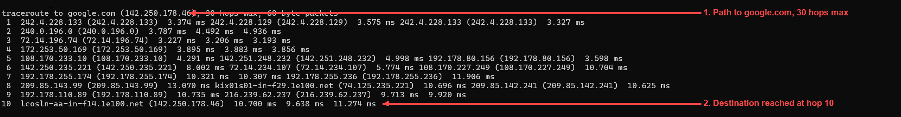
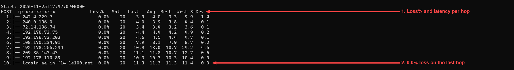

# Self study (module 05: client-server with MySQL)

## 1. Network diagnostic tools: ping and traceroute

When a connection fails, these tools tell me **where** it fails. I will need them in this module: the client must reach the MySQL server on port 3306.

### Ping

`ping` checks that a host is reachable and measures the time of a round trip.

- It sends an **ICMP Echo Request** and waits for an **ICMP Echo Reply** (ICMP works at layer 3 of the OSI model).
- It reports the **RTT** (round-trip time, in ms) and the **packet loss**.

```bash
ping -c 4 google.com        # Linux / macOS: 4 packets
ping -n 4 google.com        # Windows: 4 packets
```

| Output | Meaning |
|---|---|
| `Reply from ...` / `64 bytes from ...` | the host answers: it is reachable |
| `time=20 ms` | RTT of this packet (latency) |
| `min/avg/max` | the shortest, average and longest RTT |
| `Request timed out` / `100% packet loss` | no answer |
| `x% packet loss` | share of lost packets |

Things to remember:
- **No answer does not always mean the host is down.** Many servers block ICMP on purpose. An EC2 instance does not answer ping unless its security group allows ICMP.
- 4 packets are too few to measure a loss: 1 lost packet out of 4 is 25%, but 2 out of 500 is negligible. For a real measure I send more (`ping -c 100`, or `ping -n 100` on Windows).
- Test several destinations: if only one fails, the problem is that site, not my connection.
- `Ctrl + C` stops the ping.

### Traceroute

`traceroute` (`tracert` on Windows) shows **the path** of the packets, router by router (each router is a **hop**).

How it works: it sends packets with a growing **TTL** (Time To Live). Every router removes 1 from the TTL. When the TTL reaches 0, the router drops the packet and sends back an ICMP "Time Exceeded" message. So the first packet (TTL 1) reveals router 1, the second (TTL 2) reveals router 2, and so on, until the destination.

```bash
traceroute google.com       # Linux / macOS
tracert google.com          # Windows
```

| Part of a line | Meaning |
|---|---|
| line number | the hop (router) number |
| IP address and name | the router at this hop |
| 3 times in ms | RTT of 3 probes to this hop |
| `* * *` | no answer from this hop (often a firewall, not always a problem) |

How I read the result:
- The **number of hops** gives the distance of the destination.
- A **big jump** in the time between two hops shows where the delay appears (for example a long distance between two countries).
- If the path stops and never reaches the destination, the problem is after the last answering hop.
- `* * *` in the middle followed by normal hops is not a problem: the router just does not answer probes.

### PathPing and MTR

Both combine ping and traceroute.

| Tool | System | What it does |
|---|---|---|
| `pathping` | Windows | traces the route, then measures packet loss and latency **at each hop** for about 1 to 2 minutes (a single report) |
| `mtr` | Linux / macOS | same idea, but **in real time**: the table is updated continuously |

Columns of `mtr`: `Loss%` (loss), `Snt` (packets sent), `Last`, `Avg`, `Best`, `Wrst` (latency in ms), `StDev` (how stable the latency is).

```bash
sudo apt install -y mtr-tiny
mtr -rwc 20 google.com       # report mode: 20 packets, then a summary
```

Rule of thumb: when ping shows loss, I use `mtr` to find **which hop** loses the packets. A loss that appears at one hop and continues to the end is real. A loss at one hop only, with no loss after it, is usually a router that limits its ICMP answers.

### When to use which tool

| Question | Tool |
|---|---|
| Is the host reachable? | `ping` |
| Where does the path stop or slow down? | `traceroute` / `tracert` |
| Is there packet loss, and on which hop? | `mtr` / `pathping` |
| Is a **port** open (ping cannot tell)? | `nc -zv <host> 3306` or `telnet` |

This last line is the important one for this module: ping tests the host (layer 3), but MySQL uses **TCP port 3306** (layer 4). A server can answer ping and still refuse MySQL because of a security group or a `bind-address` setting.

### My tests

I run these on the EC2 instance `mysql-client`:

```bash
ping -c 4 google.com
traceroute google.com
mtr -rwc 20 google.com
```

**ping**: 4 packets sent, 4 received, no loss, about 11 ms per round trip.


**traceroute**: 10 hops. The times go up slowly (3 ms at the first hop, about 11 ms at the end) with no big jump, so there is no slow link on the path.



**mtr**: 20 packets on every hop, 0.0% loss everywhere, and a small `StDev`: a stable path. The first hops (`242.x`, `240.x`) are inside the AWS network.



The same `ping` towards the **private IP of the other instance** shows 100% loss, and this is expected (see [104-mysql-client.md](104-mysql-client.md)).

## 2. Basic SQL

**SQL** (Structured Query Language) is the language to talk to a relational database: create the structure, add, read, change and delete data.

| Command | Role |
|---|---|
| `SHOW` | display objects (databases, tables, columns) |
| `CREATE` | create a database, a table, a user |
| `DROP` | delete a database or a table (**permanent**) |
| `INSERT` | add rows |
| `SELECT` | read rows |

```sql
SHOW DATABASES;                      -- list the databases
CREATE DATABASE company;             -- create one
USE company;                         -- select it
SHOW TABLES;                         -- list its tables
```

Create a table. Each column has a type and optional constraints:

```sql
CREATE TABLE employees (
  id       INT PRIMARY KEY AUTO_INCREMENT,   -- unique number, filled automatically
  name     VARCHAR(100) NOT NULL,            -- text up to 100 characters, required
  position VARCHAR(50),
  salary   DECIMAL(10, 2)                    -- number with 2 decimals
);

SHOW COLUMNS FROM employees;                 -- check the structure
```

Add data:

```sql
INSERT INTO employees (name, position, salary)
VALUES ('Jane Smith', 'Developer', 60000);

INSERT INTO employees (name, position, salary)
VALUES ('Mike Johnson', 'Analyst', 55000),
       ('Anna Lee', 'Manager', 75000);       -- several rows at once
```

Read data:

```sql
SELECT * FROM employees;                                  -- everything
SELECT name, position FROM employees;                     -- some columns
SELECT name, position FROM employees WHERE salary > 55000;   -- with a condition
```

Delete:

```sql
DROP TABLE employees;                -- the table and its data are gone
DROP DATABASE company;
```

Remember:
- A command ends with `;`.
- `DROP` has **no undo** and no confirmation. On a real server I check the name of the database before.
- The guide's example inserts a row with a person's name. I use made-up data, never real personal data.
- `SELECT *` is fine to learn, but in an application I list the columns I need.

### Practice that I will do on the server

1. Log in: `sudo mysql` (on the server) or `mysql -u <user> -h <server-private-ip> -p` (from the client).
2. `SHOW DATABASES;` then create a database and a table, insert 2 or 3 rows, `SELECT` them, then `DROP` the table and the database.
3. Do the same from the **client** machine, to prove that the commands run on the remote server.

## 3. What I will build in this module

Two servers talk over the network: the **client** sends SQL queries, the **server** (the MySQL database) answers.

```
 mysql-client  ----- TCP 3306, private network ----->  mysql-server
 (mysql-client)                                         (MySQL)
```

| Course guide | What I plan to do | Why |
|---|---|---|
| Region `us-east-1`, `t2.micro` | Stockholm (`eu-north-1`), `t3.micro` | same as my other projects, free tier |
| SSH (22) open to any IP | SSH from my IP only | smaller attack surface |
| Port 3306 allowed from the client IP | port 3306 allowed from the **security group of the client** | the rule keeps working if the private IP of the client changes |
| `bind-address = 0.0.0.0` (MySQL listens everywhere) | `bind-address` set to the **private IP** of the server | MySQL is never reachable from the Internet |
| `GRANT ALL PRIVILEGES ON *.*` to the user | rights only on one database | least privilege |
| Password written in the guide | password asked at the prompt, never saved in a file | no secret in the repository |
| Two instances left running | start them only for the work, stop them after | free tier gives 750 hours per month in total, and two instances use them twice as fast |

Order of work:
1. Create `mysql-server` and `mysql-client` with their security groups (notes `102`).
2. Install MySQL server, change `bind-address`, create a database and a limited user.
3. Install `mysql-client` on the other instance and connect over the private network.
4. Run SQL queries from the client, test with `ping` and `nc`, then document the problems.
5. Stop the instances, and delete the resources when the module is validated.

## References

- [Ping and traceroute explained (Cisco)](https://www.cisco.com/c/en/us/support/docs/ios-nx-os-software/ios-software-releases-121-mainline/12778-ping-traceroute.html)
- [Using traceroute, ping, MTR and PathPing (Cloud Direct)](https://www.clouddirect.net/knowledge-base/KB0011455/using-traceroute-ping-mtr-and-pathping)
- [Basic SQL commands (freeCodeCamp)](https://www.freecodecamp.org/news/basic-sql-commands/)
- [MySQL reference manual](https://dev.mysql.com/doc/refman/8.4/en/)
