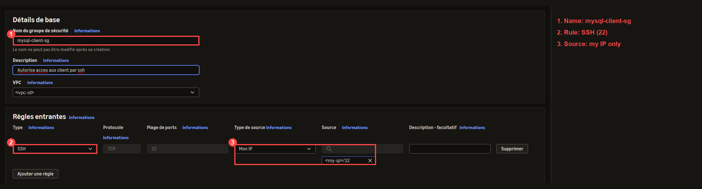
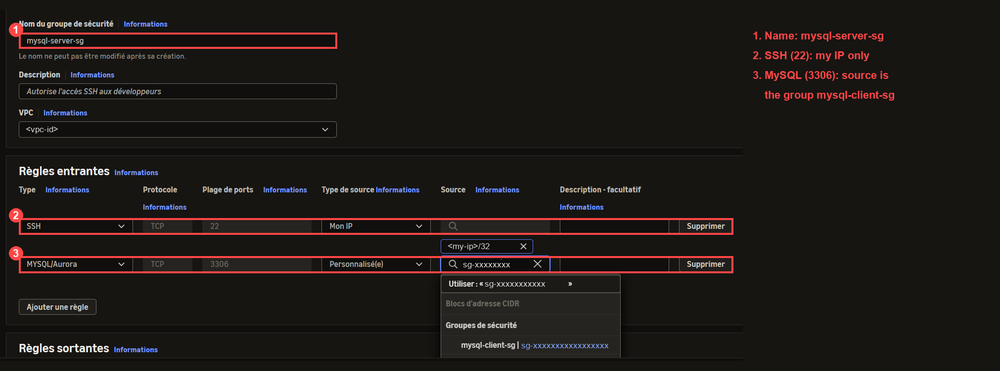
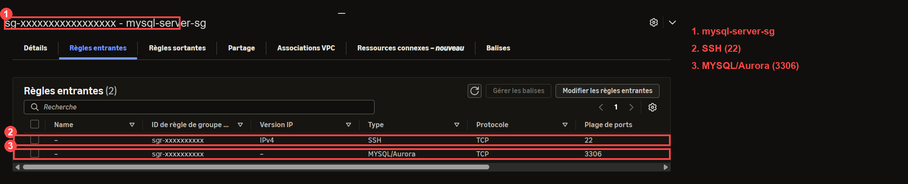
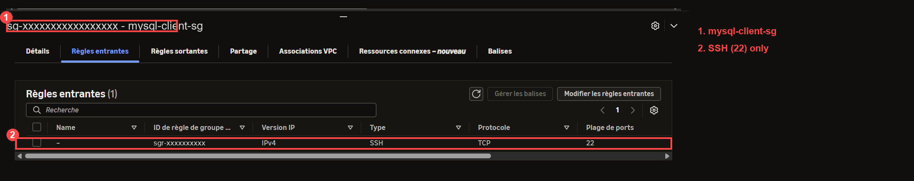
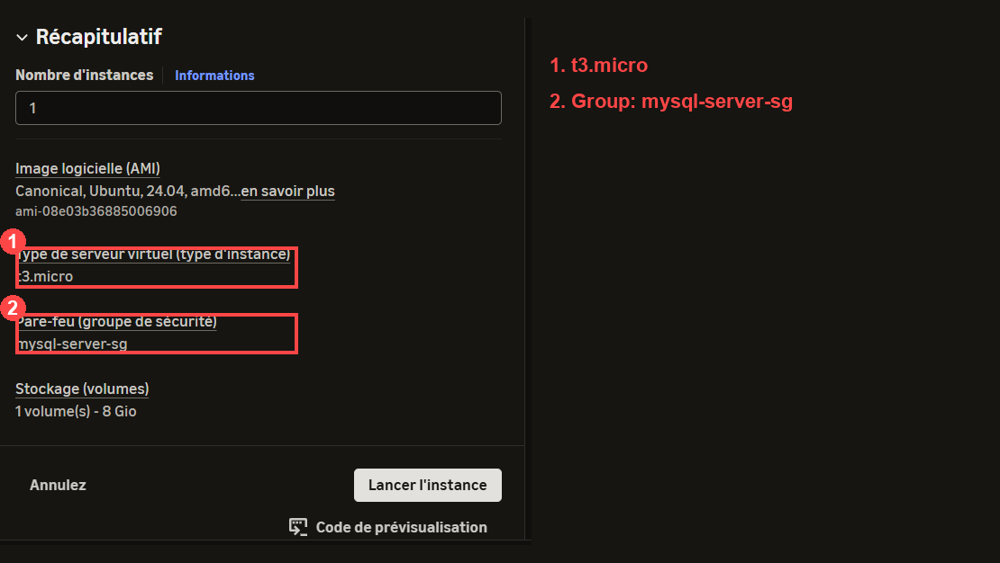
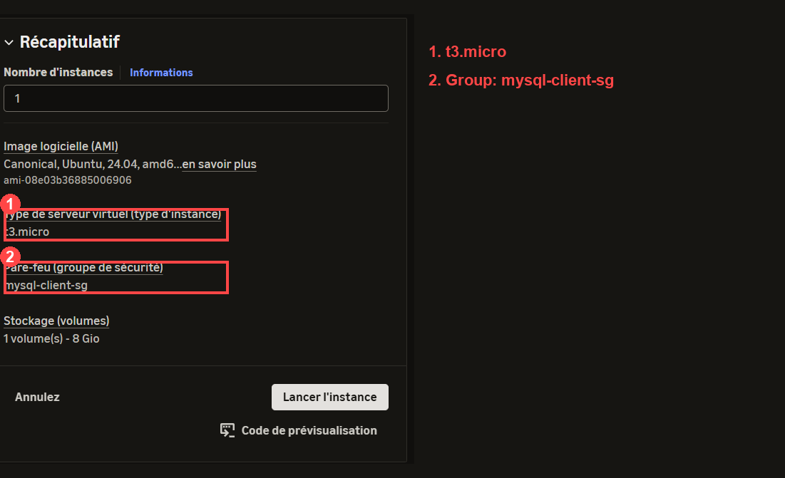
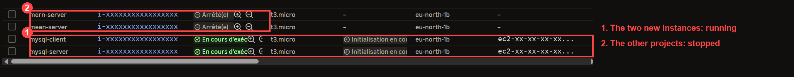

# Step 1: two EC2 instances and their security groups

A client-server setup needs two machines that talk over the network: a **server** (the MySQL database) and a **client** (the machine that sends the SQL queries). The course guide opens SSH to the whole Internet and gives the client IP in the MySQL rule. I create the security groups first, so the rule of the server can name the **group of the client** instead of an IP address.

## Security groups

One group per role, in the default VPC of Stockholm (`eu-north-1`).

| Group | Inbound rule | Source |
|---|---|---|
| `mysql-client-sg` | SSH (22) | my IP only |
| `mysql-server-sg` | SSH (22) | my IP only |
| `mysql-server-sg` | MYSQL/Aurora (3306) | the group `mysql-client-sg` |



I created `mysql-client-sg` first, because the group of the server has to select it as a source. In the source field, I choose the group in the list (`Custom` type), not an IP address.



Why a group as a source instead of the private IP of the client:
- The rule keeps working if the private IP of the client changes (new instance, replaced machine).
- Any instance with `mysql-client-sg` can reach MySQL, and nothing else can, **not even my own computer**.





The **outbound** rules stay as AWS creates them (all traffic allowed): the server needs to go out for `apt`, and the answers of a connection come back by themselves (security groups are *stateful*). I opened the outbound editor by mistake and it proposed `TCP custom, port 0`, which would have blocked everything, so I cancelled and kept the default.

## Launch the instances

| Setting | `mysql-server` | `mysql-client` |
|---|---|---|
| Region | Stockholm (`eu-north-1`) | same |
| AMI | Ubuntu Server 24.04 LTS | same |
| Instance type | `t3.micro` (free tier) | same |
| Key pair | `lamp-key` | same |
| Security group | existing: `mysql-server-sg` | existing: `mysql-client-sg` |
| Storage | 8 GiB (default) | same |





In the wizard I choose *Select existing security group*, not *Create new*, so the wizard does not make a third group.

The two instances are running. The projects of the previous modules stay stopped.



Free tier: the 750 hours per month are shared by all the running instances, so two instances use them twice as fast. I start them only to work and I stop them afterwards.

## Connect

```bash
ssh -i lamp-key.pem ubuntu@<public-ip-of-the-instance>
```

I open two terminals, one for each instance. The **public** IP changes after each stop and start. The **private** IP (`172.31.x.x`) does not change, and it is the one used between the two machines.
