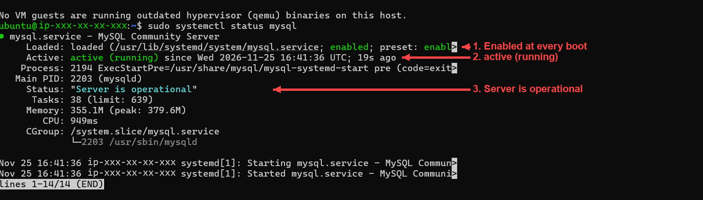
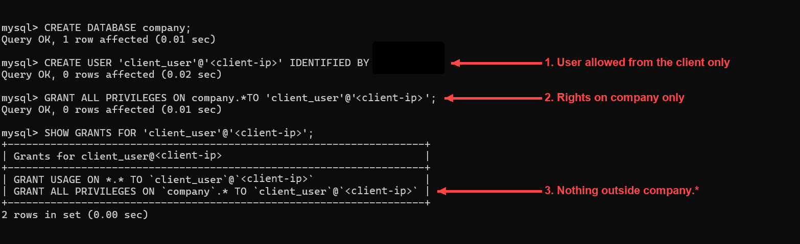

# Step 2: MySQL server

On the instance `mysql-server`.

## Install

```bash
sudo apt update
sudo apt install -y mysql-server
sudo systemctl status mysql
```

On Ubuntu the package starts the service and enables it at every boot (`enabled`).



## Which address does MySQL listen on?

```bash
sudo ss -ltnp | grep 3306
hostname -I
```

| Command | Role |
|---|---|
| `ss -ltnp` | lists the ports in `LISTEN` state (`-l` listening, `-t` TCP, `-n` numbers, `-p` process) |
| `grep 3306` | keeps only MySQL |
| `hostname -I` | prints the **private IP** of the instance |

By default MySQL listens on `127.0.0.1:3306`: only programs on the server can connect. A client on another machine would be refused, even with the right security group. (`33060` is the port of the X protocol, I do not use it.)


## Listen on the private IP

The guide sets `bind-address = 0.0.0.0` (MySQL answers on every network interface). I use the **private IP of the server** only: MySQL is never reachable from the Internet, even if a security group is wrong one day. The private IP of an instance does not change after a stop and start.

```bash
sudo sed -i 's/^bind-address.*/bind-address = <server-private-ip>/' /etc/mysql/mysql.conf.d/mysqld.cnf
grep bind-address /etc/mysql/mysql.conf.d/mysqld.cnf
sudo systemctl restart mysql
sudo ss -ltnp | grep 3306
```

| Step | What it does |
|---|---|
| `sed -i 's/^bind-address.*/.../'` | replaces the whole line that starts with `bind-address` |
| `grep` | checks the result: one line, without `#` in front |
| `systemctl restart mysql` | MySQL reads its configuration only at start |
| `ss` | the address before `:3306` is now the private IP |

`mysqlx-bind-address` stays on `127.0.0.1`: the X protocol is not needed from the network.


## Database and user with least privilege

The guide creates a user with `GRANT ALL PRIVILEGES ON *.*`: all the rights on **all** the databases, including the administration of the server. I limit the user in two ways:

- **where** it can come from: only the private IP of the client,
- **what** it can do: only the database `company`.

```bash
sudo mysql
```

```sql
CREATE DATABASE company;
CREATE USER 'client_user'@'<client-private-ip>' IDENTIFIED BY '<my-password>';
GRANT ALL PRIVILEGES ON company.* TO 'client_user'@'<client-private-ip>';
SHOW GRANTS FOR 'client_user'@'<client-private-ip>';
```

| Part | Meaning |
|---|---|
| `'client_user'@'<client-private-ip>'` | a MySQL user is a **name and a host**: the same name from another host is another user (or none) |
| `IDENTIFIED BY '<my-password>'` | the password (I chose a real one and never wrote it in the repository) |
| `company.*` | all the tables of `company` and nothing else |
| `GRANT USAGE ON *.*` | in the result: it means *no right at all* outside `company` |

`sudo mysql` works without a password on the server: it uses a local socket and the identity of `root`.



If the client is replaced by a new instance, its private IP changes and the user has to be created again with the new IP.
