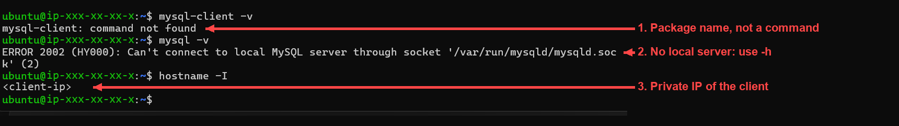
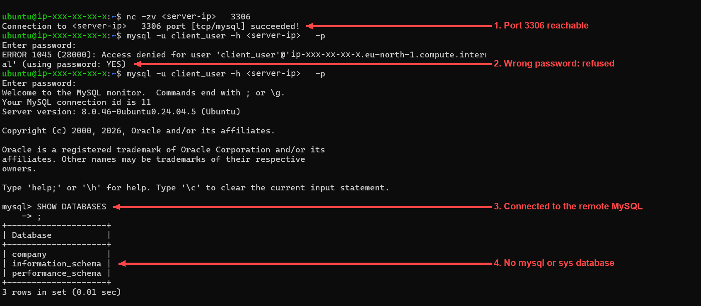
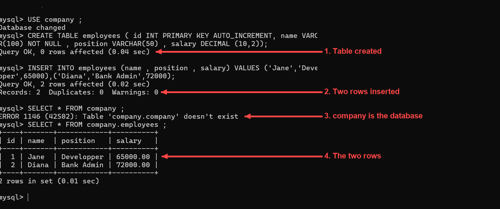
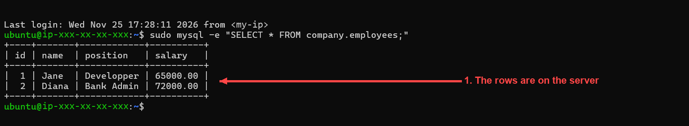
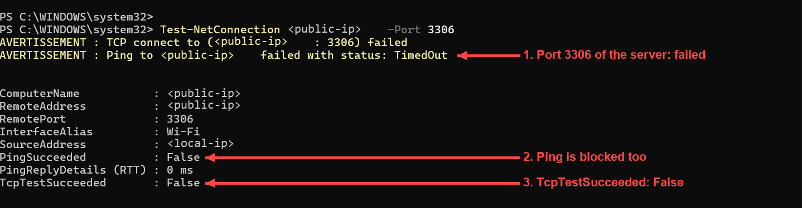
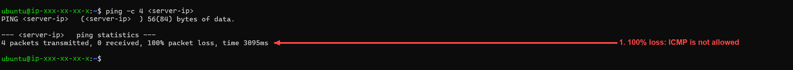
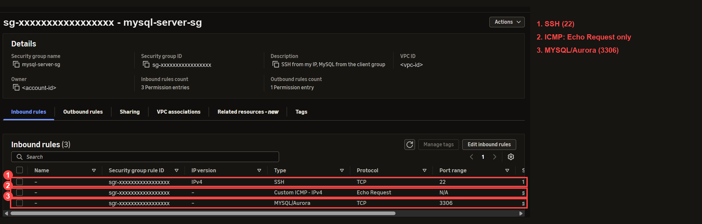
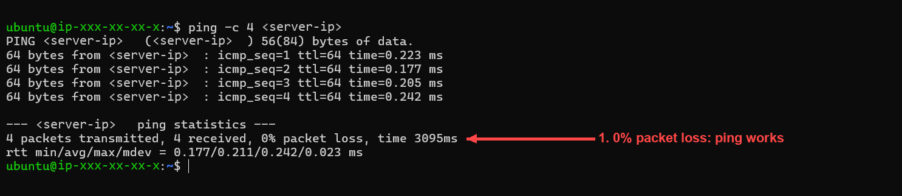

# Step 3: MySQL client and remote connection

On the instance `mysql-client`.

## Install the client

```bash
sudo apt update
sudo apt install -y mysql-client
mysql --version
hostname -I
```

The package is called `mysql-client`, but the command is **`mysql`**. `mysql-client -v` gives `command not found`.

If I run `mysql` without `-h`, it looks for a server on this same machine and fails: there is no MySQL server here, which is the point of a client-server setup.



## Test the network before MySQL

```bash
nc -zv <server-private-ip> 3306
```

`nc` (netcat) opens a network connection. `-z` only checks that the port answers, without sending data, and `-v` prints the result. It tests layer 4 of the OSI model: the **TCP port**. `ping` cannot do it, because it only tests that the machine answers (layer 3).

| Result | Probable cause |
|---|---|
| `succeeded` | the network, the security group and `bind-address` are right |
| `timed out` | the **security group** drops the packets silently |
| `Connection refused` | the machine answers but nothing listens on this address: `bind-address` or MySQL stopped |

## Connect to the remote server

```bash
mysql -u client_user -h <server-private-ip> -p
```

| Option | Role |
|---|---|
| `-u client_user` | the MySQL user |
| `-h <server-private-ip>` | the server to reach (without `-h`, the machine itself) |
| `-p` | asks the password, without showing it and without saving it in the history |

The connection goes through TCP port 3306 on the private network, **not** through SSH: the SQL commands typed on the client run on the server.

```sql
SHOW DATABASES;
```

I see `company`, `information_schema` and `performance_schema`. I do not see `mysql` or `sys`: the user has no right outside its own database.



## SQL queries from the client

I run SQL on the remote server: create a table, insert two rows, read them.

```sql
USE company;
CREATE TABLE employees (
  id INT PRIMARY KEY AUTO_INCREMENT,
  name VARCHAR(100) NOT NULL,
  position VARCHAR(50),
  salary DECIMAL(10, 2)
);
INSERT INTO employees (name, position, salary)
VALUES ('Jane', 'Developper', 65000), ('Diana', 'Bank Admin', 72000);
SELECT * FROM company.employees;
```

I use made-up names only. The `id` is filled automatically by `AUTO_INCREMENT`.

I made a mistake on the first read: `SELECT * FROM company;` gave `ERROR 1146: Table 'company.company' doesn't exist`. `company` is the name of the **database**, and `FROM` expects a **table**. The right form is `FROM employees` (after `USE company`), or `FROM company.employees` (database, then table).



## The data is on the server

I leave the `mysql` prompt (`EXIT;`) and I read the same table **on the server**. The command must run on `mysql-server`: I first typed it on the client, which gave `ERROR 2002: Can't connect to local MySQL server through socket`, because there is no MySQL on the client.

```bash
sudo mysql -e "SELECT * FROM company.employees;"
```

The two rows written from the client are stored on the server.



## Who is blocked

From my own computer (PowerShell), I test the **public** IP of the server:

```powershell
Test-NetConnection <public-ip-of-the-server> -Port 3306
```

`TcpTestSucceeded : False`: the security group only lets the group of the client reach port 3306, so my computer is refused, even though it can use SSH on port 22. The private IP cannot be tested from my computer at all: it exists only inside the AWS network.



From the client, a `ping` to the private IP of the server fails, while MySQL works on the same address:

```bash
ping -c 4 <server-private-ip>
```



The security group of the server allows only TCP 3306 (and SSH from my IP), not ICMP. So `ping` fails but the database answers. `ping` tests the machine (layer 3), `nc` tests the port (layer 4): a failing `ping` does not mean the service is down.

### Test: allow the ping, then remove the rule

To check my explanation, I add a rule to `mysql-server-sg`:

| Type | Protocol | Source |
|---|---|---|
| Custom ICMP - IPv4 | **Echo Request** | the group `mysql-client-sg` |

`ping` sends an *Echo Request*. The *Echo Reply* of the server goes back by itself (the groups are stateful), so it does not need a rule. My first try used *Echo Reply* by mistake, and my very first try used *All traffic*, which opens every port of the server to the client: far too wide for a diagnostic.



Now `ping` answers (0% packet loss, about 0.2 ms), and MySQL still works:



The rule is only for the test. I delete it afterwards, so the group goes back to SSH from my IP and MySQL from the client group.

## Three layers of protection

| Protection | Where | Question it answers |
|---|---|---|
| Security group (source = `mysql-client-sg`) | AWS, in front of the server | **Who** can reach port 3306? Only the instances of the client group |
| `bind-address` | MySQL configuration | **On which address of the server** does MySQL listen? On its own private IP, so never on the Internet |
| `'client_user'@'<client-private-ip>'` | inside MySQL | **Who can log in**, and with which rights? One user, from the client only, on `company` only |

`bind-address` is an address of the **server itself**, not the address of the client. Each layer is simple, and if one is wrong the others still protect the database.
